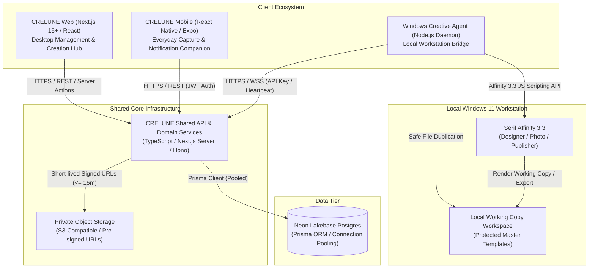
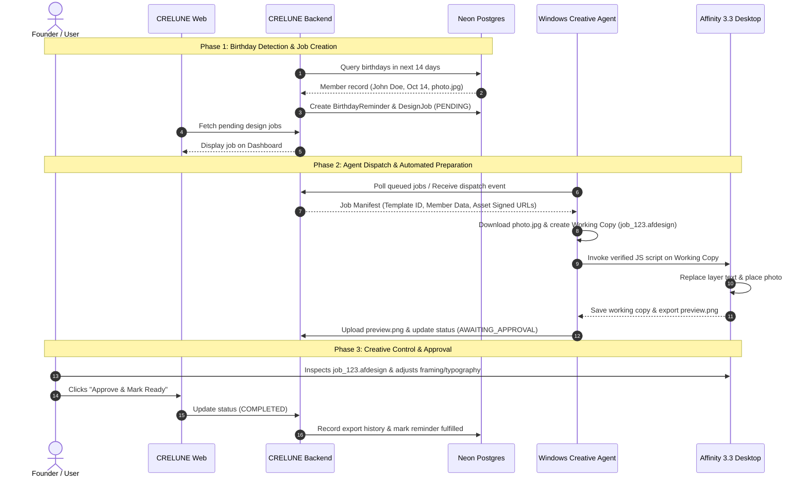

# CRELUNE — System Architecture Specification

**Document:** System Architecture & Component Boundaries  
**Project:** CRELUNE  
**Version:** 1.0  
**Status:** Approved for Milestone 0 Foundation  
**Primary Reference:** [`docs/PRODUCT_MASTER_SPECIFICATION.md`](file:///d:/Projects/Crelune/docs/PRODUCT_MASTER_SPECIFICATION.md)

---

## 1. Executive Architectural Summary

> [!IMPORTANT]
> **Implementation Status: Milestone 2 Web Foundation Implemented**
>
> As of Milestone 2, the web application foundation (`apps/web`), shared domain packages (`@crelune/shared`, `@crelune/ui`, `@crelune/database`), and Neon Lakebase Postgres persistence layer are **IMPLEMENTED**.
>
> Mobile companion (`apps/mobile`) and Windows Creative Agent (`apps/agent`) remain scheduled for Milestone 6 and Milestone 5 respectively. Subsystems are developed sequentially according to the Development Roadmap.

CRELUNE (*kreh-LOON*) is a personal creative and media operations platform designed for a single owner/operator (church media lead and graphic designer). The proposed architecture coordinates three distinct clients through a single unified backend and canonical PostgreSQL database:



---

## 2. Core Architectural Principles

1. **Personal First (Single-Owner Domain)**:
   - Initial deployment is strictly single-tenant for the founder.
   - Foreign keys and database relations maintain an `organisationId` to permit future multi-user separation, but no multi-tenant invitations, team chat, or granular RBAC are implemented in the initial release.
2. **Authoritative Central Backend**:
   - Web, Mobile, and Windows Creative Agent all communicate with the same shared backend.
   - Business rules (date calculations, birthday reminder detection, job status transitions) reside solely on the backend.
3. **Decoupled Creative Agent**:
   - The browser client **never** attempts direct local execution (no `localhost` port sniffing, no ActiveX/Node runtime in browser).
   - All desktop Affinity operations flow asynchronously via the backend-coordinated job queue.
4. **Master Template Immutability**:
   - Master Affinity (`.afdesign`, `.aftemplate`) and Photoshop (`.psd`) templates are never modified in place.
   - The Windows Creative Agent executes a mandatory byte-for-byte copy to a disposable working workspace before executing any layer operations.
5. **Privacy by Default**:
   - Church member personal information (birthdays, contact numbers, photographs) is strictly private.
   - Storage uses private buckets with short-lived pre-signed URLs ($\le 15\text{ minutes}$). Permanent public links are prohibited.

---

## 3. Subsystem Breakdown

### 3.1 CRELUNE Web (Management Workspace)
- **Technology Stack**: Next.js (App Router), React, TypeScript, Tailwind CSS, Radix UI headless accessible primitives.
- **Role**: Primary desktop command center for Windows 11 desktop browser (1080p+).
- **Core Modules**:
  1. *Dashboard*: Overview of upcoming birthdays, pending design flyers, active church programmes, and recent exports.
  2. *Members*: Church member directory, dates of birth, contact details, assigned photo assets.
  3. *Birthdays*: Calendar view, filterable by month, automatic reminder generation.
  4. *Programmes & Events*: Church services, conferences, and attached design requirements.
  5. *Design Management*: Job tracking from inception through draft, review, approval, and publication.
  6. *Template Catalog*: Registered templates, studio targets, layer field mappings.
  7. *Asset Library*: Church logos, branding graphics, high-resolution textures, member photos.
  8. *Notifications & Settings*: Operational preferences and desktop agent status.
- **Ergonomics**: High-density creative workspace with left sidebar, light-mode palette (`#6541A5` primary, `#A99AD1` lavender, `#F8F7FA` neutral background), zero decorative clutter.

### 3.2 CRELUNE Mobile (Native Companion)
- **Technology Stack**: React Native, Expo SDK, TypeScript.
- **Role**: Everyday mobile companion on iOS and Android for fast capture and reminders.
- **Strict Boundary**: **Zero WebViews.** Fully native UI components.
- **Core Capabilities**:
  - Upcoming birthday reminders and notifications.
  - Fast member photo capture via native camera (`expo-camera` / `expo-image-picker`).
  - Rapid member registration (< 30 seconds).
  - Quick design job progress check and mobile approval.
  - Native push notifications (`expo-notifications`).

### 3.3 CRELUNE Windows Creative Agent (Local Workstation Bridge)
- **Technology Stack**: Node.js / TypeScript Windows background service (or lightweight C# daemon).
- **Role**: Secure bridge connecting CRELUNE cloud/server backend to the local Windows 11 desktop and Affinity 3.3.
- **Security Posture**: Authenticates to backend via cryptographically hashed agent API tokens. Accepts only structured, validated job manifests. Executes zero arbitrary remote shell commands.
- **Affinity Automation Lifecycle**:
  ```text
  [Backend Job Manifest] 
          │
          ▼
  1. Agent downloads manifest & assets to local temp cache
  2. Agent duplicates registered Master Template -> Working Copy
  3. Agent launches/communicates with Affinity 3.3
  4. Agent executes verified Affinity JS Script (official SDK: sdk.affinity.studio/3.3.3/js/)
  5. Text node replacement & member photo placement
  6. Working copy saved; review graphic exported (PNG/JPEG)
  7. Founder visual inspection & creative fine-tuning in Affinity
  8. Final approval -> Agent uploads deliverable -> Marks COMPLETED
  ```

### 3.4 Shared Backend & API Services
- **Technology Stack**: Node.js, TypeScript, Next.js API Routes / Hono server handlers.
- **Data Access**: Prisma ORM with PostgreSQL.
- **Hosted Environment**: Neon Lakebase Postgres (AWS region: `us-east-2`), utilizing pooled connection strings for serverless application queries and unpooled direct strings for migrations.
- **Authentication**: Cryptographically signed cookie-based sessions (HMAC-SHA256, zero PII claims, `SESSION_TTL_SECONDS = 604800`, `ver` claim) with dual Node/`crypto.subtle.verify` Edge validation, database-backed active-owner & `sessionVersion` revocation checks, Origin/Referer CSRF validation on auth mutations, and durable PostgreSQL `(IP, account)` + `IP` throttling (`auth_throttles`) for Web; Bearer JWT tokens for Mobile; hashed API keys for Windows Creative Agent. Mandatory `SESSION_SECRET` ($\ge 32$ chars, fail-closed `503`).

---

## 4. Communication & Data Flow



---

## 5. Storage Architecture

| Resource Type | Storage Destination | Access Protocol | Retention Policy |
| :--- | :--- | :--- | :--- |
| **Member Photographs** | Private Object Storage Bucket (`/members/photos/`) | Pre-signed GET ($\le 15\text{ min}$) | Retained until member archived/deleted |
| **Master Templates** | Local Read-Only Directory + Storage (`/templates/master/`) | Read-only access | Permanent / Immutable |
| **Working Copies** | Local Workstation Scratch (`/workspaces/jobs/`) | Local filesystem read/write | Disposable after job export |
| **Exported Graphics** | Private Object Storage Bucket (`/exports/final/`) | Pre-signed GET | Permanent production record |
| **Logos & Church Assets** | Private Object Storage Bucket (`/assets/`) | Pre-signed GET / Cached | Active operational assets |

---

## 6. Technical Boundary Restrictions

1. **No Direct Browser Access to Filesystem**: Web browsers cannot read or write to Windows directories (`C:\`, `D:\`) or communicate with local Affinity processes directly.
2. **No Unauthenticated Public Endpoints**: All member records, photos, calendar feeds, and design assets require authenticated session credentials.
3. **No In-Place Template Mutations**: Automation scripts are physically isolated to working copy paths.
4. **No WebView Wrappers**: CRELUNE Mobile must run on native React Native components with native navigation stacks.

---

## 7. Stage 5.2 Template Backend Architecture

1. **Dedicated Private Creative Bucket (`crelune-dev-creative`)**:
   - Template masters (`TEMPLATE_MASTER`) and optional previews (`TEMPLATE_PREVIEW`) are stored in a dedicated private Neon Object Storage bucket separate from `crelune-dev-member-photos`, enforced by [`getCreativeObjectStorageConfig`](file:///d:/Projects/Crelune/apps/web/src/lib/storage/storage-config.ts) and [`NeonS3CreativeStorageProvider`](file:///d:/Projects/Crelune/apps/web/src/lib/storage/creative-storage.ts).
   - Object keys follow strict scoped prefixes (`{envPrefix}/organisations/{organisationId}/templates/{templateId}/...`) verified before signing, reading, or deletion.
2. **Authoritative Presigned PUT & Verification Lifecycle (Hardened Stage 5.2.1)**:
   - [`createTemplateUploadIntent`](file:///d:/Projects/Crelune/apps/web/src/lib/templates/template-service.ts) issues time-bounded (`<= 900s`) S3 presigned PUT URLs targeting non-versioned staging keys (`staging/masters/{uuid}.{ext}`, `staging/previews/{uuid}.{ext}`), keyed by idempotency key, and records `CreativeUploadIntent` (`PENDING`) without reserving a provisional `versionNumber`.
   - [`completeTemplateVersionUpload`](file:///d:/Projects/Crelune/apps/web/src/lib/templates/template-service.ts) downloads staged bytes under bounded stream limits (`getObjectBounded`), verifies exact `byteSize` and `sha256`, locks the parent `Template` (`FOR UPDATE`) to compute the sequential `versionNumber`, promotes verified bytes to canonical immutable keys (`versions/v{versionNumber}/{uuid}.{ext}`, `previews/v{versionNumber}/{uuid}.{ext}`), records `TemplateVersion`, and cleans up staging keys (with `CreativeStorageCleanup` fallback).
   - [`abandonUploadIntent`](file:///d:/Projects/Crelune/apps/web/src/lib/templates/template-service.ts) and [`cleanupPendingCreativeStorage`](file:///d:/Projects/Crelune/apps/web/src/lib/templates/template-service.ts) preserve `expiresAt` on abandoned intents, always enqueue `CreativeStorageCleanup`, defer final `'COMPLETED'` deletion until `expiresAt + CREATIVE_CLEANUP_EXPIRY_GRACE_MS` (`60s`), and refuse deletion of any key referenced by an active `TemplateVersion` or `ExportRecord` (`REJECTED`).
3. **Safe Manual PSD Fallback & Native Affinity Fallback (Stage 5.2.2)**:
   - Automatic PSD layer parsing (`@webtoon/psd` and worker-thread execution) is disabled in production workflows; [`validatePsdHeader`](file:///d:/Projects/Crelune/apps/web/src/lib/templates/psd-inspector.ts) performs only minimal, bounded 26-byte header validation (`8BPS` signature, PSD v1 version `1`, `1..30,000px` dimensions, `<= 100 MB` size cap).
   - Valid PSD uploads register with `inspectionStatus: 'MANUAL_REQUIRED'`, `detectedLayersJson: null`, `editabilityVerified: false`, preserved validated optional owner-supplied dimensions, and an explicit summary directing manual layer inspection and field mapping in Affinity.
   - Native Affinity documents (`.af`, `.afdesign`, `.afphoto`, `.afpub`) bypass binary parsing and register with `inspectionStatus: 'MANUAL_REQUIRED'` for artist-verified field mapping.
4. **Versioning, Rollback, Mappings & Soft Archival**:
   - Templates support immutable version history, instant active-version rollback (`PATCH /api/templates/[id]`), version-scoped `TemplateFieldMapping` replacement (`PUT /api/templates/[id]/versions/[versionId]/mappings`), and soft archival/restore (`POST .../archive`, `POST .../restore`) without breaking linked `DesignJob` history.

---

## 8. Stage 5.3 Web Catalog & Design Integration Architecture

1. **Owner-Only Catalog & Template Details Interface (`apps/web`)**:
   - Catalog view (`/templates`) provides fast client filtering by search query, template category, Affinity studio type (`VECTOR`, `PIXEL`, `LAYOUT`), and soft-archived status, backed by paginated API queries (`/api/templates`).
   - Template details view (`/templates/[id]`) presents full template metadata, active version status, immutable version history timeline with version switcher, active version rollback, soft archival/restore actions, and responsive layout.
2. **Authenticated Private Preview Card (`VersionPreviewCard`)**:
   - Preview images are never exposed via public URLs or direct S3 URLs.
   - The UI streams previews via the authenticated endpoint `/api/templates/[id]/versions/[versionId]/preview`, verifying owner session and generating short-lived stream redirects or proxy responses.
   - When no companion preview is uploaded, the UI renders an accessible placeholder illustrating the template studio type without broken images.
3. **Multi-Step Upload & Intent Workflow (`TemplateUploadModal`)**:
   - Supports creating a brand-new template with version 1 or adding a new sequential version to an existing template.
   - Computes SHA-256 and byte sizes client-side before upload using Web Cryptography (`globalThis.crypto.subtle`).
   - Requests presigned staging URLs via `POST /api/templates/upload-intents` or `/api/templates/[id]/upload-intents`.
   - Directly streams files via HTTP `PUT` to Neon Object Storage staging keys (`staging/masters/...`, `staging/previews/...`).
   - Finalizes registration via `POST /api/templates/versions`, verifying file integrity on the backend and promoting to immutable canonical keys. On failure or modal cancellation, an intent abandonment request (`POST /api/templates/upload-intents/[intentId]/abandon`) is automatically dispatched.
4. **Interactive Field Mapping Editor (`FieldMappingEditor`)**:
   - Enables the owner to configure and review dynamic layer bindings for both canonical fields (`MEMBER_FULL_NAME`, `MEMBER_FIRST_NAME`, `MEMBER_PHOTO`, `EVENT_NAME`, `EVENT_DATE`, `CHURCH_LOGO`) and custom text/image bindings.
   - Accurately conveys inspection status: renders a clear notification for `MANUAL_REQUIRED` templates (PSD and native Affinity formats) that layer names, paths, and types must be confirmed in Affinity.
   - Validates layer names, types, and paths before atomic upsertion via `PUT /api/templates/[id]/versions/[versionId]/mappings`.
5. **Design Management Module Integration**:
   - Design jobs can link to templates and specific template versions (`templateId`, `templateVersionId`).
   - Referential integrity is enforced at the database level: design jobs cannot reference an incompatible version or template from a different organisation.

---

## 9. Stage 5.4 Creative Job Preparation Architecture

1. **Exact Version Pinning & Non-Substitution**:
   - Binding a template in [`design-job-service.ts`](file:///d:/Projects/Crelune/apps/web/src/lib/designs/design-job-service.ts) immediately pins an exact immutable `TemplateVersion` (`templateVersionId`), preserving traceability even if a newer template version later becomes active.
   - Changing a job's template binding while an active `CreativeJobDispatch` exists is blocked at both application (`409 TEMPLATE_LOCKED_BY_ACTIVE_DISPATCH`) and PostgreSQL trigger (`FOR NO KEY UPDATE`) layers.
2. **Authoritative Manifest Resolution & Secret Guard**:
   - [`job-preparation-service.ts`](file:///d:/Projects/Crelune/apps/web/src/lib/designs/job-preparation-service.ts) resolves canonical (`member.*`, `design.*`) and custom (`custom.*`) mapped fields without fabricating missing values or unknown birth years.
   - Manifests are validated against `jobPrepManifestSchema` and `containsForbiddenManifestSecret()`, guaranteeing zero database credentials, storage credentials, presigned URLs, session tokens, or local paths appear inside `manifestJson`.
3. **Dual Execution Support (Agent Queue + Standalone Manual Fallback)**:
   - Owners can queue an idempotent, row-locked `CreativeJobDispatch` (`POST /api/designs/[id]/dispatches`) transitioning `DRAFT -> PENDING`, OR operate 100% standalone via authenticated manual downloads (`GET /api/designs/[id]/preparation/manifest`, `GET /api/designs/[id]/preparation/master`, `GET /api/members/[id]/photo`).
4. **Verified Deliverable Intake (`ExportRecord`)**:
   - Manual and agent exports (`PNG`, `JPEG`, `PDF` up to 50 MB) upload via presigned PUT into `crelune-dev-creative` (`exports/jobs/{designJobId}/...`), undergo magic-byte + `sharp`/PDF verification and SHA-256 matching, and always default to `isApprovedForPublish: false`, `publishedAt: null`, strictly separating `EXPORTED` from `PUBLISHED`.

---

## 10. Stage 5.5 Windows Creative Agent & Outbound Machine API Architecture

1. **Outbound-Only Machine Communication (`apps/agent` -> `apps/web`)**:
   - The standalone Windows Creative Agent (`@crelune/agent`) opens zero inbound listening ports and never requires inbound firewall access.
   - All backend traffic flows strictly outbound over HTTPS (loopback HTTP allowed exclusively for local development) using per-machine revocable Bearer tokens (`cln_agent_<64-hex>`) registered and revoked by the owner in Settings (`/settings` -> `/api/agents`).
   - [`middleware.ts`](file:///d:/Projects/Crelune/apps/web/src/middleware.ts) explicitly allowlists ONLY the 8 exact `/api/agent/*` path+method pairs (including `POST /api/agent/dispatches/[dispatchId]/lease`) for Bearer auth while keeping `/api/agents/**` behind standard owner session + CSRF enforcement.
2. **Mandatory Claim Fencing, Deadlock-Free Lock Order & Export Finalization (`Stage 5.5.1` + `5.5.2`)**:
   - All agent/owner dispatch transactions follow a strict global DAG lock order to eliminate deadlocks across PostgreSQL triggers and concurrent operations: **L0 (`creative_agents`) -> L1 (`design_jobs`, ordered by `id ASC`) -> L2 (`creative_job_dispatches`, ordered by `id ASC`) -> L3 (`creative_upload_intents`)**.
   - Every dispatch-scoped machine operation requires the `X-Crelune-Dispatch-Claim` header validated in constant time against `claimTokenHash` and unexpired `leaseExpiresAt`.
   - Export finalization ([`completeExportDeliverableUpload`](file:///d:/Projects/Crelune/apps/web/src/lib/designs/job-preparation-service.ts)) runs S3 download and binary validation off-transaction, then independently re-locks `L0 -> L1 -> L2 -> L3` inside the final transaction to revalidate active agent status, assignment, claim hash, lease validity, and idempotency before writing `ExportRecord` or transitioning the dispatch to `EXPORTED`.
   - `POST /api/agent/jobs/claim` atomically claims `QUEUED` dispatches or recovers expired leases in auto-recoverable states (`CLAIMED`, `DOWNLOADING_ASSETS`, `OPENING_TEMPLATE`, `EXPORTING`) via `L0 FOR SHARE` + `FOR UPDATE OF j, d SKIP LOCKED`, rotating `claimTokenHash` on every claim/recovery to fence stale workers.
   - `READY_FOR_ARTIST` dispatches are NEVER automatically reclaimed on lease expiry or agent revocation; they surface `requiresOwnerIntervention: true` in `DesignJobPreparationSnapshot` with concurrency-safe owner recovery (`POST /api/designs/[id]/dispatches/[dispatchId]/recover`, locking `L1 -> L2 FOR UPDATE` and protecting valid active agent leases), cancellation, or manual export fallback.
   - Active artist sessions extend leases explicitly via `POST /api/agent/dispatches/[dispatchId]/lease` (`crelune-agent renew-lease`).
   - Only `MEMBER_PHOTO` asset delivery is supported in Milestone 5; `WORKING_ASSET` is explicitly rejected at manifest schema, preparation, and streaming layers until Milestone 8 (Asset Library).
3. **Atomic Preservation-First Local Workspaces & Truthful Affinity 3.3 Integration**:
   - Each job is materialized strictly within `<workspaceRoot>/jobs/<jobId>/{source,working,assets,exports,logs}/` with path-traversal/symlink/junction rejection, SHA-256 verification, fail-closed atomic exclusive file creation (`open(..., 'wx')` inside `working/tmp/` + atomic `fs.link()`, failing closed with `AgentWorkspaceError('ATOMIC_PUBLICATION_UNSUPPORTED')` if hard links are unsupported rather than writing directly to the target path — Stage 5.5.3), and staged atomic renames for metadata files (`manifest.json`, `PREPARATION_GUIDE.txt`).
   - Original template masters in `source/` are marked read-only and verified before and after every creative action; existing working copies in `working/` and deliverables in `exports/` are preserved atomically across concurrent retries and recovery (`EEXIST` never overwrites) unless explicitly replaced via the designated approval path.
   - Verified against installed Affinity `3.3.3.5004` (`Canva.Affinity_3.3.3.5004_x64__8a0j1tnjnt4a4`): Scripting and MCP remain disabled by default and untouched. Interactive launch of allowlisted `%LOCALAPPDATA%\Microsoft\WindowsApps\Affinity.exe` requires explicit user approval (`ASSISTED` mode), falling back cleanly to `MANUAL` mode without breaking job completion or verified export submission.
