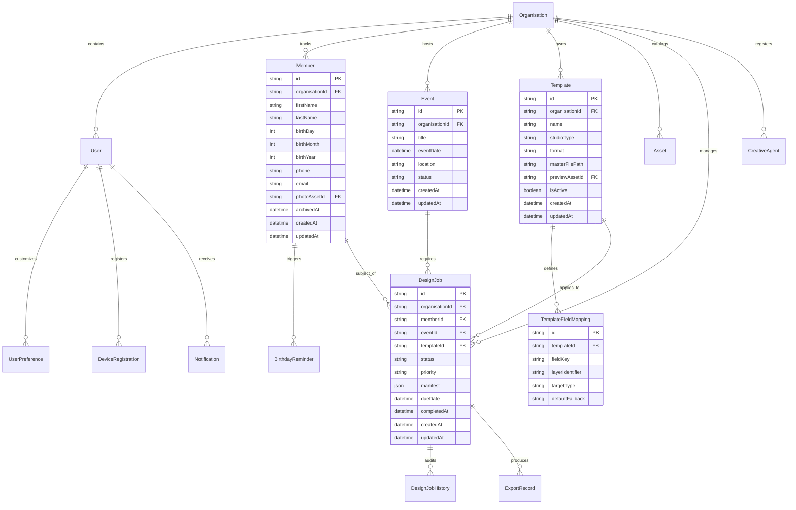

# CRELUNE — Database Design & Data Integrity Specification

**Document:** PostgreSQL Relational Schema, Prisma Models, and Data Safety Protocols  
**Project:** CRELUNE  
**Version:** 1.0  
**Status:** Approved for Milestone 0 Foundation  
**Primary Reference:** [`docs/PRODUCT_MASTER_SPECIFICATION.md`](file:///d:/Projects/Crelune/docs/PRODUCT_MASTER_SPECIFICATION.md)

---

## 1. Database Overview

> [!IMPORTANT]
> **Implementation Status: Milestone 2 Minimum Schema Applied**
>
> As of Milestone 2, the core foundation models (`Organisation`, `User`, `UserPreference`) have been synchronized with the Neon Lakebase Postgres development branch (`ep-mute-forest-bepsjmsu`).
>
> In strict accordance with Milestone 2 boundaries, future domain models (`Member`, `DesignJob`, `Template`, `Asset`, `Event`) are documented in the specification below but will only be migrated during their designated feature milestones (Milestone 3 through Milestone 8).

The proposed CRELUNE data layer will run on **PostgreSQL 15+** (hosted on **Neon Lakebase Postgres**, AWS `us-east-2`) and be managed via **Prisma ORM**.

### Dual-URL Connection Architecture
Neon's decoupled architecture provides two connection endpoints configured in `.env.local`:
1. `DATABASE_URL`: **Pooled connection** (port 5432 with `-pooler` suffix) for high-concurrency web API requests and serverless handlers.
2. `DATABASE_URL_UNPOOLED`: **Direct connection** (bypasses pgBouncer) dedicated to Prisma schema migrations (`prisma migrate dev`, `prisma db push`) and logical locking operations.

---

## 2. Entity Relationship Diagram (ERD)



---

## 3. Canonical Prisma Schema Proposal

```prisma
datasource db {
  provider  = "postgresql"
  url       = env("DATABASE_URL")
  directUrl = env("DATABASE_URL_UNPOOLED")
}

generator client {
  provider = "prisma-client-js"
}

// -----------------------------------------------------------------------------
// CORE ORGANISATION & USER MANAGEMENT (Single-Owner Baseline)
// -----------------------------------------------------------------------------

model Organisation {
  id             String          @id @default(cuid())
  name           String
  slug           String          @unique
  logoUrl        String?
  createdAt      DateTime        @default(now()) @map("created_at")
  updatedAt      DateTime        @updatedAt @map("updated_at")

  users          User[]
  members        Member[]
  events         Event[]
  templates      Template[]
  assets         Asset[]
  designJobs     DesignJob[]
  creativeAgents CreativeAgent[]

  @@map("organisations")
}

model User {
  id             String               @id @default(cuid())
  organisationId String               @map("organisation_id")
  email          String               @unique
  passwordHash   String               @map("password_hash")
  firstName      String               @map("first_name")
  lastName       String               @map("last_name")
  role           String               @default("OWNER") // OWNER, DESIGNER, MEDIA_LEAD (future)
  isActive       Boolean              @default(true) @map("is_active")
  createdAt      DateTime             @default(now()) @map("created_at")
  updatedAt      DateTime             @updatedAt @map("updated_at")

  organisation   Organisation         @relation(fields: [organisationId], references: [id], onDelete: Restrict)
  preferences    UserPreference?
  devices        DeviceRegistration[]
  notifications  Notification[]

  @@index([organisationId])
  @@map("users")
}

model UserPreference {
  id                  String   @id @default(cuid())
  userId              String   @unique @map("user_id")
  theme               String   @default("light") // light mode first
  dateFormat          String   @default("DD/MM/YYYY") @map("date_format")
  timezone            String   @default("UTC")
  leadTimeDaysBirthday Int     @default(14) @map("lead_time_days_birthday")
  leadTimeDaysEvent    Int     @default(21) @map("lead_time_days_event")
  defaultExportFormat String   @default("PNG") @map("default_export_format")
  updatedAt           DateTime @updatedAt @map("updated_at")

  user                User     @relation(fields: [userId], references: [id], onDelete: Cascade)

  @@map("user_preferences")
}

// -----------------------------------------------------------------------------
// MEMBER & BIRTHDAY DOMAIN
// -----------------------------------------------------------------------------

model Member {
  id             String             @id @default(cuid())
  organisationId String             @map("organisation_id")
  firstName      String             @map("first_name")
  lastName       String             @map("last_name")
  birthDay       Int                @map("birth_day")   // 1 - 31
  birthMonth     Int                @map("birth_month") // 1 - 12
  birthYear      Int?               @map("birth_year")  // Optional
  phone          String?
  email          String?
  notes          String?
  photoAssetId   String?            @map("photo_asset_id")
  archivedAt     DateTime?          @map("archived_at") // Soft delete
  createdAt      DateTime           @default(now()) @map("created_at")
  updatedAt      DateTime           @updatedAt @map("updated_at")

  organisation   Organisation       @relation(fields: [organisationId], references: [id], onDelete: Restrict)
  photoAsset     Asset?             @relation("MemberPhoto", fields: [photoAssetId], references: [id], onDelete: SetNull)
  reminders      BirthdayReminder[]
  designJobs     DesignJob[]

  // High-performance index for birthday calendar and upcoming query window
  @@index([organisationId, birthMonth, birthDay])
  @@index([archivedAt])
  @@map("members")
}

model BirthdayReminder {
  id             String    @id @default(cuid())
  memberId       String    @map("member_id")
  targetYear     Int       @map("target_year")
  reminderDate   DateTime  @map("reminder_date")
  isTriggered    Boolean   @default(false) @map("is_triggered")
  isFulfilled    Boolean   @default(false) @map("is_fulfilled") // Marked fulfilled when flyer is completed
  createdAt      DateTime  @default(now()) @map("created_at")

  member         Member    @relation(fields: [memberId], references: [id], onDelete: Cascade)

  @@unique([memberId, targetYear])
  @@index([reminderDate, isTriggered])
  @@map("birthday_reminders")
}

// -----------------------------------------------------------------------------
// PROGRAMMES & EVENTS DOMAIN
// -----------------------------------------------------------------------------

model Event {
  id             String      @id @default(cuid())
  organisationId String      @map("organisation_id")
  title          String
  description    String?
  eventDate      DateTime    @map("event_date")
  location       String?
  status         String      @default("UPCOMING") // UPCOMING, IN_PROGRESS, COMPLETED, CANCELLED
  createdAt      DateTime    @default(now()) @map("created_at")
  updatedAt      DateTime    @updatedAt @map("updated_at")

  organisation   Organisation @relation(fields: [organisationId], references: [id], onDelete: Restrict)
  designJobs     DesignJob[]

  @@index([organisationId, eventDate])
  @@map("events")
}

// -----------------------------------------------------------------------------
// DESIGN JOB & WORKFLOW TRACKING (Authoritative Milestone 4 Implementation)
// -----------------------------------------------------------------------------

enum DesignCategory {
  BIRTHDAY_FLYER
  CHURCH_PROGRAMME_FLYER
  EVENT_ANNOUNCEMENT
  SERVICE_FLYER
  SOCIAL_MEDIA_GRAPHIC
  SPECIAL_EVENT_ARTWORK
  GENERAL_GRAPHIC_DESIGN
}

enum DesignJobStatus {
  DRAFT
  PENDING
  IN_PROGRESS
  AWAITING_REVIEW
  APPROVED
  EXPORTED
  PUBLISHED
  CANCELLED
}

enum DesignPriority {
  LOW
  NORMAL
  HIGH
  URGENT
}

model DesignJob {
  id                    String             @id @default(cuid())
  organisationId        String             @map("organisation_id")
  memberId              String?            @map("member_id")
  birthdayTargetYear    Int?               @map("birthday_target_year")
  title                 String
  category              DesignCategory     @default(GENERAL_GRAPHIC_DESIGN)
  status                DesignJobStatus    @default(DRAFT)
  priority              DesignPriority     @default(NORMAL)
  requiredText          String?            @map("required_text")
  dimensions            String?
  targetPlatform        String?            @map("target_platform")
  preferredTemplateNote String?            @map("preferred_template_note")
  referenceNotes        String?            @map("reference_notes")
  notes                 String?
  dueDate               DateTime?          @map("due_date") @db.Date
  approvedAt            DateTime?          @map("approved_at")
  exportedAt            DateTime?          @map("exported_at")
  publishedAt           DateTime?          @map("published_at")
  cancelledAt           DateTime?          @map("cancelled_at")
  createdAt             DateTime           @default(now()) @map("created_at")
  updatedAt             DateTime           @updatedAt @map("updated_at")
  // Note: eventId (Milestone 7) and templateId (Milestone 5) attach cleanly in future milestones.

  organisation          Organisation       @relation(fields: [organisationId], references: [id], onDelete: Restrict)
  member                Member?            @relation(fields: [memberId], references: [id], onDelete: SetNull)
  birthdayPreparations  BirthdayPreparation[]
  history               DesignJobHistory[]

  @@index([organisationId, status])
  @@index([organisationId, memberId])
  @@index([dueDate])
  @@map("design_jobs")
}

model DesignJobHistory {
  id              String           @id @default(cuid())
  organisationId  String           @map("organisation_id")
  designJobId     String           @map("design_job_id")
  previousStatus  DesignJobStatus? @map("previous_status")
  newStatus       DesignJobStatus  @map("new_status")
  note            String?
  changedByUserId String?          @map("changed_by_user_id")
  createdAt       DateTime         @default(now()) @map("created_at")

  organisation    Organisation     @relation(fields: [organisationId], references: [id], onDelete: Restrict)
  designJob       DesignJob        @relation(fields: [designJobId], references: [id], onDelete: Cascade)
  changedByUser   User?            @relation(fields: [changedByUserId], references: [id], onDelete: SetNull)

  @@index([organisationId, designJobId, createdAt])
  @@map("design_job_history")
}

// -----------------------------------------------------------------------------
// TEMPLATES & AFFINITY INTEGRATION
// -----------------------------------------------------------------------------

model Template {
  id             String                 @id @default(cuid())
  organisationId String                 @map("organisation_id")
  name           String
  studioType     String                 @map("studio_type") // PIXEL, VECTOR, LAYOUT
  format         String                 // AFDESIGN, AFTEMPLATE, AFPHOTO, PSD
  masterFilePath String                 @map("master_file_path") // Relative local path or storage key
  previewAssetId String?                @map("preview_asset_id")
  isActive       Boolean                @default(true) @map("is_active")
  createdAt      DateTime               @default(now()) @map("created_at")
  updatedAt      DateTime               @updatedAt @map("updated_at")

  organisation   Organisation           @relation(fields: [organisationId], references: [id], onDelete: Restrict)
  previewAsset   Asset?                 @relation("TemplatePreview", fields: [previewAssetId], references: [id], onDelete: SetNull)
  fieldMappings  TemplateFieldMapping[]
  designJobs     DesignJob[]

  @@index([organisationId, isActive])
  @@map("templates")
}

model TemplateFieldMapping {
  id              String   @id @default(cuid())
  templateId      String   @map("template_id")
  fieldKey        String   @map("field_key")        // e.g. "member_name", "birth_date"
  layerIdentifier String   @map("layer_identifier") // Target layer name or ID in Affinity
  targetType      String   @map("target_type")      // TEXT, PLACED_IMAGE, SHAPE_FILL
  defaultFallback String?  @map("default_fallback")
  createdAt       DateTime @default(now()) @map("created_at")

  template        Template @relation(fields: [templateId], references: [id], onDelete: Cascade)

  @@unique([templateId, fieldKey])
  @@map("template_field_mappings")
}

// -----------------------------------------------------------------------------
// ASSETS & DELIVERABLES
// -----------------------------------------------------------------------------

model Asset {
  id             String     @id @default(cuid())
  organisationId String     @map("organisation_id")
  category       String     // MEMBER_PHOTO, LOGO, BACKGROUND, TEMPLATE_PREVIEW, EXPORT_OUTPUT
  storageKey     String     @unique @map("storage_key") // Private object storage key
  fileName       String     @map("file_name")
  fileSize       Int        @map("file_size")
  mimeType       String     @map("mime_type")
  width          Int?
  height         Int?
  tags           String[]   @default([])
  archivedAt     DateTime?  @map("archived_at")
  createdAt      DateTime   @default(now()) @map("created_at")

  organisation   Organisation @relation(fields: [organisationId], references: [id], onDelete: Restrict)
  memberPhotos   Member[]     @relation("MemberPhoto")
  templatePreviews Template[] @relation("TemplatePreview")
  exportRecords  ExportRecord[]

  @@index([organisationId, category])
  @@map("assets")
}

model ExportRecord {
  id             String    @id @default(cuid())
  designJobId    String    @map("design_job_id")
  assetId        String    @map("asset_id")
  format         String    // PNG, JPEG, PDF
  resolutionDpi  Int       @default(300) @map("resolution_dpi")
  exportDurationMs Int?    @map("export_duration_ms")
  createdAt      DateTime  @default(now()) @map("created_at")

  designJob      DesignJob @relation(fields: [designJobId], references: [id], onDelete: Cascade)
  asset          Asset     @relation(fields: [assetId], references: [id], onDelete: Restrict)

  @@index([designJobId])
  @@map("export_records")
}

// -----------------------------------------------------------------------------
// INFRASTRUCTURE & AGENT AUDIT
// -----------------------------------------------------------------------------

model CreativeAgent {
  id             String    @id @default(cuid())
  organisationId String    @map("organisation_id")
  agentName      String    @map("agent_name")
  machineHostname String   @map("machine_hostname")
  tokenHash      String    @unique @map("token_hash")
  affinityVersion String?  @map("affinity_version")
  lastHeartbeat  DateTime  @default(now()) @map("last_heartbeat")
  isOnline       Boolean   @default(false) @map("is_online")
  createdAt      DateTime  @default(now()) @map("created_at")

  organisation   Organisation @relation(fields: [organisationId], references: [id], onDelete: Restrict)

  @@index([organisationId])
  @@map("creative_agents")
}

model Notification {
  id             String    @id @default(cuid())
  userId         String    @map("user_id")
  title          String
  body           String
  channel        String    // IN_APP, PUSH, EMAIL
  isRead         Boolean   @default(false) @map("is_read")
  actionUrl      String?   @map("action_url")
  createdAt      DateTime  @default(now()) @map("created_at")

  user           User      @relation(fields: [userId], references: [id], onDelete: Cascade)

  @@index([userId, isRead])
  @@map("notifications")
}

model DeviceRegistration {
  id             String    @id @default(cuid())
  userId         String    @map("user_id")
  pushToken      String    @unique @map("push_token")
  platform       String    // IOS, ANDROID
  deviceName     String?   @map("device_name")
  updatedAt      DateTime  @updatedAt @map("updated_at")

  user           User      @relation(fields: [userId], references: [id], onDelete: Cascade)

  @@map("device_registrations")
}
```

---

## 4. Migration & Operational Safety Rules

1. **Non-Destructive Migrations Only**:
   - Every schema change must be generated using `prisma migrate dev --create-only --name <descriptive_name>`.
   - The generated SQL file in `prisma/migrations/` must be manually reviewed before execution to verify no `DROP TABLE` or `DROP COLUMN` commands are present.
2. **Soft Deletes Mandatory on Primary Records**:
   - Models `Member` and `Asset` utilize `archivedAt DateTime?`.
   - Application queries must filter `where: { archivedAt: null }` by default. Hard deletes are reserved for GDPR/Privacy right-to-be-forgotten requests.
3. **Multi-Step Updates in Prisma Transactions**:
   - State-changing operations (such as creating/updating a `DesignJob`, inserting its `DesignJobHistory` audit row, and reconciling `BirthdayPreparation.designJobId`) must execute atomically inside `prisma.$transaction`.
   - Active (`status !== 'CANCELLED'`) `BIRTHDAY_FLYER` uniqueness per `(organisationId, memberId, birthdayTargetYear)` and `BirthdayPreparation.designJobId` ownership reconciliation are serialized in PostgreSQL using transaction-scoped deterministic SHA-256 advisory locks (`pg_advisory_xact_lock(int4, int4)`) acquired in sorted order, plus `FOR UPDATE` row locking on `design_jobs` during updates and status transitions (see [ADR 014](./TECHNICAL_DECISIONS.md#adr-014--birthday-design-job-uniqueness-advisory-locking--preparation-reconciliation)).
4. **Direct URL Migration Execution**:
   - Prisma Migrate must strictly connect via `DATABASE_URL_UNPOOLED` to prevent pgBouncer connection pooling from interfering with transactional DDL schema migration statements.
