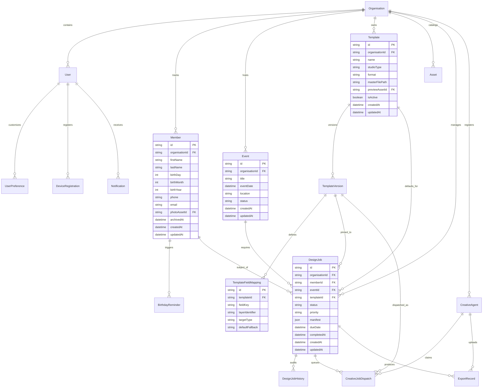

# CRELUNE — Database Design & Data Integrity Specification

**Document:** PostgreSQL Relational Schema, Prisma Models, and Data Safety Protocols  
**Project:** CRELUNE  
**Version:** 1.0  
**Status:** Approved for Milestone 0 Foundation  
**Primary Reference:** [`docs/PRODUCT_MASTER_SPECIFICATION.md`](file:///d:/Projects/Crelune/docs/PRODUCT_MASTER_SPECIFICATION.md)

---

## 1. Database Overview

> [!IMPORTANT]
> **Implementation Status: Milestone 5 Stage 5.1 Schema Applied on Neon Development**
>
> Through Stage 5.1, the authoritative implemented schema in [`packages/database/prisma/schema.prisma`](file:///d:/Projects/Crelune/packages/database/prisma/schema.prisma) covers Foundation (`Organisation`, `User`, `UserPreference`, `AuthThrottle`), Members & Birthdays (`Member`, `BirthdayPreparation`, `BirthdayReminder`, `Notification`, `AuditLog`, `PendingStorageCleanup`), Design Management (`DesignJob`, `DesignJobHistory`), and Stage 5.1 Templates, Creative Storage & Windows Agent Contracts (`Template`, `TemplateVersion`, `TemplateFieldMapping`, `CreativeUploadIntent`, `CreativeAgent`, `CreativeJobDispatch`, `ExportRecord`, `CreativeStorageCleanup`), synchronized to the Neon `development` branch (`br-nameless-silence-bexjp44k`).
>
> Future domain modules (`Event`, general `Asset`, `DeviceRegistration`) remain draft design specifications below until their designated milestones (Milestone 6–8).

The proposed CRELUNE data layer will run on **PostgreSQL 15+** (hosted on **Neon Lakebase Postgres**, AWS `us-east-2`) and be managed via **Prisma ORM**.

### Dual-URL Connection Architecture
Neon's decoupled architecture provides two connection endpoints configured in `.env.local`:
1. `DATABASE_URL`: **Pooled connection** (port 5432 with `-pooler` suffix) for high-concurrency web API requests and serverless handlers.
2. `DATABASE_URL_UNPOOLED`: **Direct connection** (bypasses pgBouncer) dedicated to Prisma schema migrations (`prisma migrate dev`, `prisma db push`) and logical locking operations.

---

## 2. Entity Relationship Diagram (ERD)



---

## 3. Canonical Prisma Schema Proposal

```prisma
datasource db {
  provider  = "postgresql"
  url       = env("DATABASE_URL")
  directUrl = env("DATABASE_URL_UNPOOLED")
}

generator client {
  provider = "prisma-client-js"
}

// -----------------------------------------------------------------------------
// CORE ORGANISATION & USER MANAGEMENT (Single-Owner Baseline)
// -----------------------------------------------------------------------------

model Organisation {
  id             String          @id @default(cuid())
  name           String
  slug           String          @unique
  logoUrl        String?
  createdAt      DateTime        @default(now()) @map("created_at")
  updatedAt      DateTime        @updatedAt @map("updated_at")

  users          User[]
  members        Member[]
  events         Event[]
  templates      Template[]
  assets         Asset[]
  designJobs     DesignJob[]
  creativeAgents CreativeAgent[]

  @@map("organisations")
}

model User {
  id             String               @id @default(cuid())
  organisationId String               @map("organisation_id")
  email          String               @unique
  passwordHash   String               @map("password_hash")
  firstName      String               @map("first_name")
  lastName       String               @map("last_name")
  role           String               @default("OWNER") // OWNER, DESIGNER, MEDIA_LEAD (future)
  isActive       Boolean              @default(true) @map("is_active")
  createdAt      DateTime             @default(now()) @map("created_at")
  updatedAt      DateTime             @updatedAt @map("updated_at")

  organisation   Organisation         @relation(fields: [organisationId], references: [id], onDelete: Restrict)
  preferences    UserPreference?
  devices        DeviceRegistration[]
  notifications  Notification[]

  @@index([organisationId])
  @@map("users")
}

model UserPreference {
  id                  String   @id @default(cuid())
  userId              String   @unique @map("user_id")
  theme               String   @default("light") // light mode first
  dateFormat          String   @default("DD/MM/YYYY") @map("date_format")
  timezone            String   @default("UTC")
  leadTimeDaysBirthday Int     @default(14) @map("lead_time_days_birthday")
  leadTimeDaysEvent    Int     @default(21) @map("lead_time_days_event")
  defaultExportFormat String   @default("PNG") @map("default_export_format")
  updatedAt           DateTime @updatedAt @map("updated_at")

  user                User     @relation(fields: [userId], references: [id], onDelete: Cascade)

  @@map("user_preferences")
}

// -----------------------------------------------------------------------------
// MEMBER & BIRTHDAY DOMAIN
// -----------------------------------------------------------------------------

model Member {
  id             String             @id @default(cuid())
  organisationId String             @map("organisation_id")
  firstName      String             @map("first_name")
  lastName       String             @map("last_name")
  birthDay       Int                @map("birth_day")   // 1 - 31
  birthMonth     Int                @map("birth_month") // 1 - 12
  birthYear      Int?               @map("birth_year")  // Optional
  phone          String?
  email          String?
  notes          String?
  photoAssetId   String?            @map("photo_asset_id")
  archivedAt     DateTime?          @map("archived_at") // Soft delete
  createdAt      DateTime           @default(now()) @map("created_at")
  updatedAt      DateTime           @updatedAt @map("updated_at")

  organisation   Organisation       @relation(fields: [organisationId], references: [id], onDelete: Restrict)
  photoAsset     Asset?             @relation("MemberPhoto", fields: [photoAssetId], references: [id], onDelete: SetNull)
  reminders      BirthdayReminder[]
  designJobs     DesignJob[]

  // High-performance index for birthday calendar and upcoming query window
  @@index([organisationId, birthMonth, birthDay])
  @@index([archivedAt])
  @@map("members")
}

model BirthdayReminder {
  id             String    @id @default(cuid())
  memberId       String    @map("member_id")
  targetYear     Int       @map("target_year")
  reminderDate   DateTime  @map("reminder_date")
  isTriggered    Boolean   @default(false) @map("is_triggered")
  isFulfilled    Boolean   @default(false) @map("is_fulfilled") // Marked fulfilled when flyer is completed
  createdAt      DateTime  @default(now()) @map("created_at")

  member         Member    @relation(fields: [memberId], references: [id], onDelete: Cascade)

  @@unique([memberId, targetYear])
  @@index([reminderDate, isTriggered])
  @@map("birthday_reminders")
}

// -----------------------------------------------------------------------------
// PROGRAMMES & EVENTS DOMAIN
// -----------------------------------------------------------------------------

model Event {
  id             String      @id @default(cuid())
  organisationId String      @map("organisation_id")
  title          String
  description    String?
  eventDate      DateTime    @map("event_date")
  location       String?
  status         String      @default("UPCOMING") // UPCOMING, IN_PROGRESS, COMPLETED, CANCELLED
  createdAt      DateTime    @default(now()) @map("created_at")
  updatedAt      DateTime    @updatedAt @map("updated_at")

  organisation   Organisation @relation(fields: [organisationId], references: [id], onDelete: Restrict)
  designJobs     DesignJob[]

  @@index([organisationId, eventDate])
  @@map("events")
}

// -----------------------------------------------------------------------------
// DESIGN JOB & WORKFLOW TRACKING (Authoritative Milestone 4 Implementation)
// -----------------------------------------------------------------------------

enum DesignCategory {
  BIRTHDAY_FLYER
  CHURCH_PROGRAMME_FLYER
  EVENT_ANNOUNCEMENT
  SERVICE_FLYER
  SOCIAL_MEDIA_GRAPHIC
  SPECIAL_EVENT_ARTWORK
  GENERAL_GRAPHIC_DESIGN
}

enum DesignJobStatus {
  DRAFT
  PENDING
  IN_PROGRESS
  AWAITING_REVIEW
  APPROVED
  EXPORTED
  PUBLISHED
  CANCELLED
}

enum DesignPriority {
  LOW
  NORMAL
  HIGH
  URGENT
}

model DesignJob {
  id                    String             @id @default(cuid())
  organisationId        String             @map("organisation_id")
  memberId              String?            @map("member_id")
  birthdayTargetYear    Int?               @map("birthday_target_year")
  title                 String
  category              DesignCategory     @default(GENERAL_GRAPHIC_DESIGN)
  status                DesignJobStatus    @default(DRAFT)
  priority              DesignPriority     @default(NORMAL)
  requiredText          String?            @map("required_text")
  dimensions            String?
  targetPlatform        String?            @map("target_platform")
  preferredTemplateNote String?            @map("preferred_template_note")
  templateId            String?            @map("template_id")
  templateVersionId     String?            @map("template_version_id")
  referenceNotes        String?            @map("reference_notes")
  notes                 String?
  dueDate               DateTime?          @map("due_date") @db.Date
  approvedAt            DateTime?          @map("approved_at")
  exportedAt            DateTime?          @map("exported_at")
  publishedAt           DateTime?          @map("published_at")
  cancelledAt           DateTime?          @map("cancelled_at")
  createdAt             DateTime           @default(now()) @map("created_at")
  updatedAt             DateTime           @updatedAt @map("updated_at")
  // Note: eventId (Milestone 7) and templateId (Milestone 5) attach cleanly in future milestones.

  organisation          Organisation       @relation(fields: [organisationId], references: [id], onDelete: Restrict)
  member                Member?            @relation(fields: [memberId], references: [id], onDelete: SetNull)
  birthdayPreparations  BirthdayPreparation[]
  history               DesignJobHistory[]

  @@index([organisationId, status])
  @@index([organisationId, memberId])
  @@index([dueDate])
  @@map("design_jobs")
}

model DesignJobHistory {
  id              String           @id @default(cuid())
  organisationId  String           @map("organisation_id")
  designJobId     String           @map("design_job_id")
  previousStatus  DesignJobStatus? @map("previous_status")
  newStatus       DesignJobStatus  @map("new_status")
  note            String?
  changedByUserId String?          @map("changed_by_user_id")
  createdAt       DateTime         @default(now()) @map("created_at")

  organisation    Organisation     @relation(fields: [organisationId], references: [id], onDelete: Restrict)
  designJob       DesignJob        @relation(fields: [designJobId], references: [id], onDelete: Cascade)
  changedByUser   User?            @relation(fields: [changedByUserId], references: [id], onDelete: SetNull)

  @@index([organisationId, designJobId, createdAt])
  @@map("design_job_history")
}

// -----------------------------------------------------------------------------
// TEMPLATES, CREATIVE STORAGE & WINDOWS AGENT (Authoritative Stage 5.1)
// -----------------------------------------------------------------------------

enum TemplateStudioType {
  AFFINITY_PHOTO
  AFFINITY_DESIGNER
  AFFINITY_PUBLISHER
  AFFINITY_STUDIO
}

enum TemplateFileFormat {
  PSD
  AF
  AFPHOTO
  AFDESIGN
  AFPUB
}

enum TemplateInspectionStatus {
  PENDING
  INSPECTED
  MANUAL_REQUIRED
  FAILED
}

enum TemplateFieldType {
  TEXT
  IMAGE
  DATE
  COLOR
}

enum CreativeUploadKind {
  TEMPLATE_MASTER
  TEMPLATE_PREVIEW
  WORKING_ASSET
  EXPORT_DELIVERABLE
}

enum CreativeUploadStatus {
  PENDING
  VERIFIED
  REJECTED
  EXPIRED
  ABANDONED
}

enum CreativeAgentStatus {
  ACTIVE
  REVOKED
}

enum CreativeDispatchStatus {
  QUEUED
  CLAIMED
  DOWNLOADING_ASSETS
  OPENING_TEMPLATE
  READY_FOR_ARTIST
  EXPORTING
  EXPORTED
  FAILED
  CANCELLED
}

enum ExportFileFormat {
  PNG
  JPEG
  PDF
}

enum CreativeStorageCleanupReason {
  UPLOAD_ABANDONED
  UPLOAD_REJECTED
  TEMPLATE_VERSION_RETIRED
  DISPATCH_CLEANUP
  EXPORT_SUPERSEDED
}

model Template {
  id              String             @id @default(cuid())
  organisationId  String             @map("organisation_id")
  name            String
  normalizedName  String             @map("normalized_name")
  category        DesignCategory     @default(GENERAL_GRAPHIC_DESIGN)
  studioType      TemplateStudioType @map("studio_type")
  description     String?
  activeVersionId String?            @unique @map("active_version_id")
  createdByUserId String             @map("created_by_user_id")
  isActive        Boolean            @default(true) @map("is_active")
  archivedAt      DateTime?          @map("archived_at")
  createdAt       DateTime           @default(now()) @map("created_at")
  updatedAt       DateTime           @updatedAt @map("updated_at")

  @@index([organisationId, category, isActive])
  @@index([organisationId, archivedAt])
  @@index([organisationId, normalizedName])
  @@map("templates")
}

model TemplateVersion {
  id                 String                   @id @default(cuid())
  organisationId     String                   @map("organisation_id")
  templateId         String                   @map("template_id")
  versionNumber      Int                      @map("version_number")
  format             TemplateFileFormat
  storageBucket      String                   @map("storage_bucket")
  storageKey         String                   @unique @map("storage_key")
  previewStorageKey  String?                  @unique @map("preview_storage_key")
  previewMimeType    String?                  @map("preview_mime_type")
  previewByteSize    Int?                     @map("preview_byte_size")
  originalFilename   String                   @map("original_filename")
  mimeType           String                   @map("mime_type")
  byteSize           Int                      @map("byte_size")
  sha256             String
  widthPx            Int?                     @map("width_px")
  heightPx           Int?                     @map("height_px")
  inspectionStatus   TemplateInspectionStatus @default(PENDING) @map("inspection_status")
  inspectionSummary  String?                  @map("inspection_summary")
  detectedLayersJson Json?                    @map("detected_layers_json")
  inspectedAt        DateTime?                @map("inspected_at")
  uploadedByUserId   String                   @map("uploaded_by_user_id")
  uploadIntentId     String?                  @unique @map("upload_intent_id")
  createdAt          DateTime                 @default(now()) @map("created_at")

  @@unique([templateId, versionNumber])
  @@index([organisationId, templateId, createdAt])
  @@map("template_versions")
}

model TemplateFieldMapping {
  id                String            @id @default(cuid())
  organisationId    String            @map("organisation_id")
  templateVersionId String            @map("template_version_id")
  fieldKey          String            @map("field_key")
  fieldType         TemplateFieldType @map("field_type")
  targetLayerName   String            @map("target_layer_name")
  layerPathJson     Json?             @map("layer_path_json")
  isRequired        Boolean           @default(false) @map("is_required")
  defaultValue      String?           @map("default_value")
  notes             String?
  createdAt         DateTime          @default(now()) @map("created_at")
  updatedAt         DateTime          @updatedAt @map("updated_at")

  @@unique([templateVersionId, fieldKey])
  @@index([organisationId, templateVersionId])
  @@map("template_field_mappings")
}

model CreativeUploadIntent {
  id                String               @id @default(cuid())
  organisationId    String               @map("organisation_id")
  requestedByUserId String?              @map("requested_by_user_id")
  agentId           String?              @map("agent_id")
  kind              CreativeUploadKind
  idempotencyKey    String               @unique @map("idempotency_key")
  storageBucket     String               @map("storage_bucket")
  storageKey        String               @unique @map("storage_key")
  expectedMimeType  String               @map("expected_mime_type")
  expectedByteSize  Int                  @map("expected_byte_size")
  expectedSha256    String?              @map("expected_sha256")
  maxAllowedBytes   Int                  @map("max_allowed_bytes")
  status            CreativeUploadStatus @default(PENDING)
  verifiedByteSize  Int?                 @map("verified_byte_size")
  verifiedSha256    String?              @map("verified_sha256")
  rejectionReason   String?              @map("rejection_reason")
  expiresAt         DateTime             @map("expires_at")
  verifiedAt        DateTime?            @map("verified_at")
  createdAt         DateTime             @default(now()) @map("created_at")
  updatedAt         DateTime             @updatedAt @map("updated_at")

  @@index([organisationId, status, expiresAt])
  @@index([agentId, status])
  @@map("creative_upload_intents")
}

model CreativeAgent {
  id                 String              @id @default(cuid())
  organisationId     String              @map("organisation_id")
  registeredByUserId String              @map("registered_by_user_id")
  name               String
  machineLabel       String              @map("machine_label")
  tokenHash          String              @unique @map("token_hash")
  tokenPrefix        String              @map("token_prefix")
  status             CreativeAgentStatus @default(ACTIVE)
  agentVersion       String?             @map("agent_version")
  affinityVersion    String?             @map("affinity_version")
  capabilitiesJson   Json?               @map("capabilities_json")
  lastHeartbeatAt    DateTime?           @map("last_heartbeat_at")
  revokedAt          DateTime?           @map("revoked_at")
  revokedByUserId    String?             @map("revoked_by_user_id")
  revocationReason   String?             @map("revocation_reason")
  createdAt          DateTime            @default(now()) @map("created_at")
  updatedAt          DateTime            @updatedAt @map("updated_at")

  @@index([organisationId, status])
  @@map("creative_agents")
}

model CreativeJobDispatch {
  id                String                 @id @default(cuid())
  organisationId    String                 @map("organisation_id")
  designJobId       String                 @map("design_job_id")
  templateVersionId String                 @map("template_version_id")
  assignedAgentId   String?                @map("assigned_agent_id")
  requestedByUserId String                 @map("requested_by_user_id")
  idempotencyKey    String                 @unique @map("idempotency_key")
  manifestVersion   Int                    @default(1) @map("manifest_version")
  manifestJson      Json                   @map("manifest_json")
  status            CreativeDispatchStatus @default(QUEUED)
  claimTokenHash    String?                @map("claim_token_hash")
  leaseExpiresAt    DateTime?              @map("lease_expires_at")
  claimedAt         DateTime?              @map("claimed_at")
  readyForArtistAt  DateTime?              @map("ready_for_artist_at")
  completedAt       DateTime?              @map("completed_at")
  failedAt          DateTime?              @map("failed_at")
  errorCode         String?                @map("error_code")
  errorMessage      String?                @map("error_message")
  createdAt         DateTime               @default(now()) @map("created_at")
  updatedAt         DateTime               @updatedAt @map("updated_at")

  @@index([organisationId, status, createdAt])
  @@index([designJobId, createdAt])
  @@index([assignedAgentId, status])
  @@map("creative_job_dispatches")
}

model ExportRecord {
  id                    String           @id @default(cuid())
  organisationId        String           @map("organisation_id")
  designJobId           String           @map("design_job_id")
  dispatchId            String?          @map("dispatch_id")
  uploadedByAgentId     String?          @map("uploaded_by_agent_id")
  uploadedByUserId      String?          @map("uploaded_by_user_id")
  uploadIntentId        String?          @unique @map("upload_intent_id")
  format                ExportFileFormat
  storageBucket         String           @map("storage_bucket")
  storageKey            String           @unique @map("storage_key")
  mimeType              String           @map("mime_type")
  byteSize              Int              @map("byte_size")
  sha256                String
  widthPx               Int?             @map("width_px")
  heightPx              Int?             @map("height_px")
  resolutionDpi         Int?             @map("resolution_dpi")
  isApprovedForPublish  Boolean          @default(false) @map("is_approved_for_publish")
  ownerApprovedAt       DateTime?        @map("owner_approved_at")
  ownerApprovedByUserId String?          @map("owner_approved_by_user_id")
  publishedAt           DateTime?        @map("published_at")
  createdAt             DateTime         @default(now()) @map("created_at")

  @@index([organisationId, designJobId, createdAt])
  @@index([dispatchId])
  @@map("export_records")
}

model CreativeStorageCleanup {
  id             String                       @id @default(cuid())
  organisationId String                       @map("organisation_id")
  bucket         String
  objectKey      String                       @unique @map("object_key")
  reason         CreativeStorageCleanupReason
  status         StorageCleanupStatus         @default(PENDING)
  attempts       Int                          @default(0)
  lastError      String?                      @map("last_error")
  nextRetryAt    DateTime                     @default(now()) @map("next_retry_at")
  resolvedAt     DateTime?                    @map("resolved_at")
  createdAt      DateTime                     @default(now()) @map("created_at")
  updatedAt      DateTime                     @updatedAt @map("updated_at")

  @@index([status, nextRetryAt])
  @@index([organisationId, createdAt])
  @@map("creative_storage_cleanups")
}

// -----------------------------------------------------------------------------
// FUTURE ASSETS (Milestone 8 Draft Specification)
// -----------------------------------------------------------------------------

model Asset {
  id             String     @id @default(cuid())
  organisationId String     @map("organisation_id")
  category       String     // MEMBER_PHOTO, LOGO, BACKGROUND, TEMPLATE_PREVIEW, EXPORT_OUTPUT
  storageKey     String     @unique @map("storage_key") // Private object storage key
  fileName       String     @map("file_name")
  fileSize       Int        @map("file_size")
  mimeType       String     @map("mime_type")
  width          Int?
  height         Int?
  tags           String[]   @default([])
  archivedAt     DateTime?  @map("archived_at")
  createdAt      DateTime   @default(now()) @map("created_at")

  organisation   Organisation @relation(fields: [organisationId], references: [id], onDelete: Restrict)
  memberPhotos   Member[]     @relation("MemberPhoto")

  @@index([organisationId, category])
  @@map("assets")
}

// -----------------------------------------------------------------------------
// INFRASTRUCTURE & NOTIFICATIONS
// -----------------------------------------------------------------------------

model Notification {
  id             String    @id @default(cuid())
  userId         String    @map("user_id")
  title          String
  body           String
  channel        String    // IN_APP, PUSH, EMAIL
  isRead         Boolean   @default(false) @map("is_read")
  actionUrl      String?   @map("action_url")
  createdAt      DateTime  @default(now()) @map("created_at")

  user           User      @relation(fields: [userId], references: [id], onDelete: Cascade)

  @@index([userId, isRead])
  @@map("notifications")
}

model DeviceRegistration {
  id             String    @id @default(cuid())
  userId         String    @map("user_id")
  pushToken      String    @unique @map("push_token")
  platform       String    // IOS, ANDROID
  deviceName     String?   @map("device_name")
  updatedAt      DateTime  @updatedAt @map("updated_at")

  user           User      @relation(fields: [userId], references: [id], onDelete: Cascade)

  @@map("device_registrations")
}
```

---

## 4. Migration & Operational Safety Rules

1. **Non-Destructive Migrations Only**:
   - Every schema change must be generated using `prisma migrate dev --create-only --name <descriptive_name>`.
   - The generated SQL file in `prisma/migrations/` must be manually reviewed before execution to verify no `DROP TABLE` or `DROP COLUMN` commands are present.
2. **Soft Deletes Mandatory on Primary Records**:
   - Models `Member` and `Asset` utilize `archivedAt DateTime?`.
   - Application queries must filter `where: { archivedAt: null }` by default. Hard deletes are reserved for GDPR/Privacy right-to-be-forgotten requests.
3. **Multi-Step Updates in Prisma Transactions**:
   - State-changing operations (such as creating/updating a `DesignJob`, inserting its `DesignJobHistory` audit row, and reconciling `BirthdayPreparation.designJobId`) must execute atomically inside `prisma.$transaction`.
   - Active (`status !== 'CANCELLED'`) `BIRTHDAY_FLYER` uniqueness per `(organisationId, memberId, birthdayTargetYear)` and `BirthdayPreparation.designJobId` ownership reconciliation are serialized in PostgreSQL using transaction-scoped deterministic SHA-256 advisory locks (`pg_advisory_xact_lock(int4, int4)`) acquired in sorted order, plus `FOR UPDATE` row locking on `design_jobs` during updates and status transitions (see [ADR 014](./TECHNICAL_DECISIONS.md#adr-014--birthday-design-job-uniqueness-advisory-locking--preparation-reconciliation)).
4. **Direct URL Migration Execution**:
   - Prisma Migrate must strictly connect via `DATABASE_URL_UNPOOLED` to prevent pgBouncer connection pooling from interfering with transactional DDL schema migration statements.
