# CRELUNE — Phased Development Roadmap

**Document:** Milestone Sequence, Deliverables, and Completion Criteria  
**Project:** CRELUNE  
**Version:** 1.0  
**Status:** Approved for Milestone 0 Foundation  
**Primary Reference:** [`docs/PRODUCT_MASTER_SPECIFICATION.md`](file:///d:/Projects/Crelune/docs/PRODUCT_MASTER_SPECIFICATION.md)

---

## 1. Roadmap Strategy & Milestone Sequence

CRELUNE (*kreh-LOON*) follows a strict, sequential milestone structure. Features from future milestones are never implemented prematurely. Each milestone must pass verified automated tests and receive Product Owner sign-off before subsequent phases begin:

```mermaid
flowchart LR
    M0["M0: Foundation\n(Specs, Architecture, Git)"] --> M1["M1: Affinity Validation\n(SDK, Scripts, PSD/Native)"]
    M1 --> M2["M2: Web Foundation\n(Next.js Shell, Auth)"]
    M2 --> M3["M3: Members & Birthdays\n(Records, Calendar, Triggers)"]
    M3 --> M4["M4: Design Management\n(Job Queues, Statuses)"]
    M4 --> M5["M5: Template Automation\n(Windows Agent, Field Map)"]
    M5 --> M6["M6: Mobile App\n(React Native, Capture)"]
    M6 --> M7["M7: Programmes & Events\n(Church Calendar)"]
    M7 --> M8["M8: Asset Library\n(Media Vault, Storage)"]
    M8 --> M9["M9: QA & Production\n(Audit, Security, Launch)"]
```

---

## 2. Detailed Milestone Specifications

### Milestone 0 — Product Foundation *(Status: COMPLETE)*
- **Objective**: Establish development standards, technical architecture, database schema, design tokens, automated testing setup, and repository hygiene.
- **Key Deliverables**:
  - Central operating rules (`.agents/AGENTS.md`) and 9 specialized AI skills.
  - Complete architecture, database design, design system, and security specifications.
  - Initialized Git baseline repository connected to GitHub (`origin/main`).
  - Neon Lakebase Postgres database linked with non-secret `.env.example`.
- **Exit Criteria**: All documentation authored, verified without unsupported claims, Git working tree clean, and Product Owner approval received.

### Milestone 1 — Affinity 3.3 Technical Validation *(Status: COMPLETE / EMPIRICAL BOUNDARIES)*
- **Objective**: Empirically validate Affinity 3.3 JavaScript scripting capabilities on Windows 11 before building dependent automation.
- **Key Deliverables**:
  - Local workstation environment audit (Affinity 3.3 MSIX package verification).
  - Test harness with zero simulation verifying template immutability (`STRICT PASS`).
  - Mapped official Canva `JSLib` DOM hierarchy (`document.js`, `nodes.js`).
  - Discovered dormant local MCP socket in 3.3.1.4940; established contingency architecture (ADR 008).
- **Exit Criteria**: Truthful empirical validation report delivered and accepted.

### Milestone 2 — Web Foundation *(Status: COMPLETE)*
- **Objective**: Build the core Next.js web application architecture, owner authentication, and responsive layout shell.
- **Key Deliverables**:
  - Next.js 15 App Router application (`apps/web`).
  - Owner-only authentication (scrypt password derivation, HMAC-SHA256 tamper-evident session cookies, `HttpOnly` security).
  - Server-side route protection via Next.js middleware intercepting unauthenticated traffic.
  - Responsive application shell with desktop sidebar and mobile slide-over drawer using CRELUNE design tokens (`#6541A5`).
  - Minimum Neon Lakebase Postgres database foundation (`Organisation`, `User`, `UserPreference`) synchronized via Prisma.
  - Shared design tokens and accessible UI components in `@crelune/ui`.
  - Local owner provisioning CLI script (`scripts/create-owner.mjs`).
- **Exit Criteria**: Owner can log in, view responsive dashboard shell, navigate module foundations, and verify database connectivity. Automated vitest and Next.js production builds pass.

### Milestone 3 — Members & Birthdays *(Completed)*
- **Objective**: Implement member directory, birthday calendar, and automated reminder calculation.
- **Key Deliverables**:
  - Member management UI (Add, Edit, Soft-delete/Archive, Restore, View Member Profile, Duplicate Confirmation).
  - Private member photograph upload pipeline on Neon Object Storage (`sharp` re-encoding, EXIF stripping, magic-byte validation, private authenticated streaming).
  - Birthday calendar and operational windows with monthly filtering and upcoming window calculation (Today / Next 7 Days / Current Month / Next 30 Days).
  - Leap year (February 29 `FEB_28` / `MAR_1`) birthday logic and timezone-safe civil date calculations.
  - Automated reminder generation, due-reminder processor (`POST /api/cron/birthday-reminders` + manual sync), in-app notifications centre, and birthday preferences settings.
- **Exit Criteria**: Verified end-to-end member registration, birthday recording, calendar operations, preparation status updates, and reminder generation.

### Milestone 4 — Design Management *(Completed)*
- **Objective**: Implement the design job tracking pipeline from brief to review, export confirmation, and explicit publication.
- **Key Deliverables**:
  - Authoritative `DesignJob` state machine (`DRAFT`, `PENDING`, `IN_PROGRESS`, `AWAITING_REVIEW`, `APPROVED`, `EXPORTED`, `PUBLISHED`, `CANCELLED` per `PRODUCT_MASTER_SPECIFICATION.md` Module 4) keeping `EXPORTED` and `PUBLISHED` strictly separate.
  - Design job creation and editing connected to members and `BirthdayPreparation` flyer workflows (`BirthdayTargetYear`).
  - Visual status board & table list views on Web dashboard with search, category, priority, and status filtering.
  - `DesignJobHistory` immutable audit logging with actor attribution and transition notes.
  - Design brief detail, review, export confirmation, and publication workflow interface.
- **Exit Criteria**: Job created, linked to members/birthdays, transitioned through valid status gates, and logged in immutable audit history.

### Milestone 5 — Templates & Affinity Integration
- **Objective**: Register templates, map placeholder fields, and integrate the Windows Creative Agent.
- **Key Deliverables**:
  - Template catalog UI (Studio types: Pixel, Vector, Layout).
  - Layer field mapping interface (linking member name and photo to target layers).
  - Windows Creative Agent local daemon connecting to backend job queue.
  - Automated job processing (download manifest $\rightarrow$ copy template $\rightarrow$ execute Affinity script $\rightarrow$ export preview).
  - Founder creative handoff checkpoint in Affinity desktop.
- **Exit Criteria**: Founder can trigger a birthday job, agent prepares working copy in Affinity 3.3, exports preview, and awaits final approval.

### Milestone 6 — Mobile Application
- **Objective**: Develop the native React Native & Expo companion mobile application.
- **Key Deliverables**:
  - Native Expo application scaffold (`apps/mobile`) with zero WebViews.
  - Native bottom tab navigation (Home, Calendar, Designs, Members, More).
  - Native camera & gallery image capture (`expo-image-picker`) with client-side compression.
  - Fast member registration screen optimized for mobile input (< 30 seconds).
  - Push and local notification delivery (`expo-notifications`) for birthday alerts.
- **Exit Criteria**: Member registered with photo from phone, birthday reminder received on mobile lock screen.

### Milestone 7 — Programmes & Events
- **Objective**: Church event and programme management with linked creative deliverables.
- **Key Deliverables**:
  - Church event creation (Date, time, location, theme).
  - Programme materials checklist (Flyer, Announcement Slide, Projection Asset).
  - Direct linking between events and Design Jobs.
  - Calendar integration combining birthdays and church events.
- **Exit Criteria**: Church event created with attached design requirement; design completion marks event asset ready.

### Milestone 8 — Asset Library
- **Objective**: Centralized repository for frequently used creative resources.
- **Key Deliverables**:
  - Categorized asset storage (Logos, Backgrounds, Textures, Finished Artwork).
  - Asset upload with automatic width/height extraction and thumbnail generation.
  - Tag-based search and filtering.
  - Usage tracking (referencing which design jobs or members use which asset).
- **Exit Criteria**: Church logos and textures cataloged, searchable, and selectable in design workflows.

### Milestone 9 — Quality Assurance & Production Release
- **Objective**: Comprehensive regression testing, security review, performance audit, and production readiness.
- **Key Deliverables**:
  - End-to-end test suite execution across all core user workflows.
  - Security audit (OWASP Top 10 check, secret scanning, IDOR verification).
  - Backup and recovery drill on Neon Postgres database.
  - Performance profiling (ensuring sub-100ms API response times).
  - Final Product Owner sign-off and production release documentation.
- **Exit Criteria**: Zero known critical/high bugs, 100% passing tests, and written deployment authorization.
