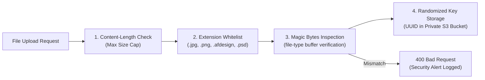

# CRELUNE — Security, Privacy & Compliance Specification

**Document:** Security Posture, Data Privacy Controls, and Threat Defense Architecture  
**Project:** CRELUNE  
**Version:** 1.0  
**Status:** Approved for Milestone 0 Foundation  
**Primary Reference:** [`docs/PRODUCT_MASTER_SPECIFICATION.md`](file:///d:/Projects/Crelune/docs/PRODUCT_MASTER_SPECIFICATION.md)

---

## 1. Security Philosophy & Threat Model

CRELUNE (*kreh-LOON*) manages personal church community records, family birthdays, member photographs, and creative assets. The founder acts as the sole custodian of this sensitive data.

### Threat Model Matrix

| Threat Vector | Potential Impact | CRELUNE Defense Strategy |
| :--- | :--- | :--- |
| **Public Member Directory Harvesting** | Leakage of church members' names, birth dates, and photos. | Strictly authenticated endpoints; zero unauthenticated public API routes or pages. |
| **Direct S3 / Storage Scraping** | Unauthorized access to member photos or proprietary templates. | Private-by-default buckets; short-lived pre-signed URLs ($\le 15\text{ min}$) with randomized keys. |
| **Malicious File Uploads** | Remote code execution or server compromise via manipulated images. | Dual-layer validation (file extension + magic byte header inspection) and strict size limits. |
| **Arbitrary Remote Command Execution** | Compromise of the founder's Windows workstation via the Agent. | Agent accepts only validated JSON manifests; executes zero arbitrary shell scripts. |
| **Credential & Secret Leaks** | Unauthorized database access or account hijacking. | Zero hardcoded fallback secrets; typed environment validation; `.env*` excluded by `.gitignore`. |
| **SQL Injection & Data Corruption** | Data theft or unauthorized database deletion. | Exclusively parameterized queries via Prisma ORM; non-destructive migration protocols. |

---

## 2. Church Member Privacy Protection Protocol

Church members entrust their personal details to the founder. CRELUNE enforces rigorous privacy standards:

1. **No Public Directories**:
   - Member lists, birthdays, and photographs cannot be queried without an authenticated session.
   - Search indexing (`robots.txt: Disallow: /`) and authentication middleware prevent accidental web crawling.
2. **Access-Controlled Media Storage**:
   - Photographs are never stored with predictable filenames (e.g. `/uploads/photos/1.jpg`).
   - Objects are stored under secure UUID keys: `/members/photos/${uuid}.${extension}`.
   - Images are served solely via pre-signed, time-limited URLs generated upon request for authenticated users (expiry: $15\text{ minutes}$).
3. **Explicit Publication Approval**:
   - The preparation or export of a birthday flyer does not imply permission for automatic public broadcasting.
   - Exported artwork must undergo manual review and approval by the founder before release.

---

## 3. Authentication & Session Architecture

### 3.1 Web Authentication
- **Mechanism**: Secure HTTP-only cookie sessions.
- **Cookie Security Attributes**:
  - `HttpOnly: true` (Prevents client-side JavaScript / XSS access).
  - `Secure: true` (Enforced HTTPS transmission in production).
  - `SameSite: Lax` (Mitigates Cross-Site Request Forgery).
- **Password Storage**: Argon2id or bcrypt with a minimum work factor of 12 rounds. Plaintext or reversibly encrypted passwords are strictly prohibited.
- **No Public Registration**: Self-service registration routes are disabled. Initial setup creates the single owner account via secure CLI initialization.

### 3.2 Mobile Authentication
- **Mechanism**: Cryptographically signed JSON Web Tokens (JWT) or session tokens stored securely on the device using `expo-secure-store` (iOS Keychain / Android Keystore).
- **Token Expiry & Refresh**: Short-lived access tokens (1 hour) coupled with revocable refresh tokens stored in PostgreSQL.

### 3.3 Windows Creative Agent Authentication
- **Mechanism**: Dedicated API key generated per machine.
- **Storage**: The backend stores only a salted cryptographic hash (`tokenHash` via SHA-256) of the agent's key. The raw secret is held locally on the Windows workstation in encrypted user storage.
- **Heartbeat & Revocation**: The agent reports heartbeats every 60 seconds; an administrator can instantly revoke an agent's access from the Web dashboard.

---

## 4. File Upload Defense & Validation

All file uploads (member photos, PSDs, Affinity templates, logo assets) must pass a mandatory 4-step security pipeline before storage:



### File Size Limits
- **Member Photographs**: Maximum $10\text{ MB}$.
- **Affinity Templates & PSDs**: Maximum $100\text{ MB}$.
- **General Creative Assets (Logos/Textures)**: Maximum $50\text{ MB}$.

---

## 5. Windows Creative Agent Safety Constraints

To protect the founder's Windows 11 workstation from remote execution vulnerabilities:

1. **Restricted Job Manifests**: The agent communicates via structured JSON manifests:
   ```json
   {
     "jobId": "job_cuid123",
     "templateId": "tmpl_cuid456",
     "textReplacements": {
       "member_name": "Bro. John Doe",
       "birth_date": "Sunday, 14th October"
     },
     "assetUrl": "https://storage.crelune.com/signed/photo.png?token=..."
   }
   ```
2. **Zero Shell Command Execution**: The agent never accepts shell command strings, batch scripts, or executable binaries from API payloads.
3. **Template Immutability**: All modifications execute on a newly created copy inside a sandboxed job scratch directory (`workspaces/jobs/{jobId}/`). Original templates are marked read-only on the local filesystem.
4. **Process Isolation**: The agent only manages verified Affinity 3.3 processes (`Designer.exe`, `Photo.exe`, `Publisher.exe`).

---

## 6. Secret Hygiene & Environment Management

1. **Zero Hardcoded Secrets**: Secrets must never be committed to source control or hardcoded with fallback values (e.g. `const secret = process.env.SECRET || "dev_secret"` is strictly prohibited).
2. **Strict Git Exclusions**: All `.env*` files are excluded in `.gitignore`. A sanitized template ([`.env.example`](file:///d:/Projects/Crelune/.env.example)) provides non-secret documentation.
3. **Database Parameterization**: All queries use Prisma ORM parameterized queries. Raw string concatenation in SQL is prohibited.
4. **Sanitized Error Responses**: API errors returned to clients must never reveal stack traces, database table structures, or local file system paths:
   ```json
   {
     "success": false,
     "error": {
       "code": "UNAUTHORIZED",
       "message": "Authentication required."
     }
   }
   ```

---

## 7. Milestone 2 Authentication Implementation Controls

Implemented in Milestone 2:
1. **Owner-Only Authentication**:
   - Single-owner baseline strictly enforces that only one owner account exists.
   - Public registration, invitation routes, and client-side account creation are strictly absent.
   - Account provisioning is performed exclusively via the local CLI script [`scripts/create-owner.mjs`](file:///d:/Projects/Crelune/scripts/create-owner.mjs).
2. **Cryptographic Password Security**:
   - Passwords hashed using Node's native `crypto.scrypt` with a random 16-byte salt and constant-time verification ([`apps/web/src/lib/auth/password.ts`](file:///d:/Projects/Crelune/apps/web/src/lib/auth/password.ts)).
3. **Tamper-Evident Session Management**:
   - Session tokens are cryptographically signed using HMAC-SHA256 backed by `SESSION_SECRET` ($\ge 32$ characters) ([`apps/web/src/lib/auth/session.ts`](file:///d:/Projects/Crelune/apps/web/src/lib/auth/session.ts)). Note: session tokens are signed (tamper-evident integrity), not encrypted.
   - Session cookies use `HttpOnly`, `SameSite=Lax`, `Path=/`, and `Secure` in production.
   - Dual-engine verification supports both Node.js server components and Web Crypto Edge runtime in Next.js middleware ([`apps/web/src/middleware.ts`](file:///d:/Projects/Crelune/apps/web/src/middleware.ts)).
4. **Server-Side Route Interception**:
   - Unauthenticated requests to dashboard routes (`/`, `/members`, `/birthdays`, etc.) are intercepted by `middleware.ts` and redirected to `/login`.
   - Protected API routes return `401 Unauthorized` without session cookies.

---

## 8. Milestone 2.1 Security Hardening Specification

Implemented as part of Milestone 2.1 corrective hardening:

1. **Complete Elimination of Fallback Session Secrets**:
   - Hardcoded development fallbacks are completely removed.
   - `SESSION_SECRET` is strictly required in all environments (development, test, production) with a minimum length of 32 characters.
   - All session issuance, verification, and middleware fail closed if `SESSION_SECRET` is missing or insufficient.

2. **Minimized Session Token Claims (Zero PII in Cookies)**:
   - Session cookies carry only minimal operational claims: `{ sub, role: "OWNER", org, iat, exp }`.
   - Personally identifiable information (PII) such as full names and email addresses are never stored in client cookies.
   - Server components and API routes query owner profile details directly from the database using `session.sub`.
   - Strict Zod validation ([`sessionTokenPayloadSchema`](file:///d:/Projects/Crelune/packages/shared/src/schemas/auth.ts)) validates payload structure, positive integer timestamps, clock skew ($\le 60\text{s}$), and enforces `role === 'OWNER'`.

3. **Strict Middleware Route Interception**:
   - Eliminated the permissive `pathname.includes('.')` bypass rule.
   - Whitelist restricted exclusively to internal Next.js assets (`/_next/static`, `/_next/image`, `/favicon.ico`) and exact public routes with strict HTTP method checking:
     - `/login` (GET)
     - `/api/auth/login` (POST only)
     - `/api/auth/logout` (POST only)
     - `/api/health` (GET only)
   - All other routes—including dotted private API endpoints such as `/api/export.json` or `/api/members.csv`—are strictly intercepted and return `401 Unauthorized` when unauthenticated.

4. **Login Anti-Enumeration & Durable Throttling**:
   - Constant-time dummy `scrypt` password verification executes when a queried user does not exist or is inactive, neutralizing response timing enumeration.
   - Account lockout state is tracked durably in PostgreSQL via `failedLoginAttempts` and `lockedUntil`.
   - Accounts lock for 15 minutes after 5 consecutive failed attempts.
   - Generic error responses (`"Invalid email or password"`) are returned for all credential failures without leaking account existence or database error strings.
   - Request payloads are capped at 4KB to mitigate resource exhaustion attacks.

5. **Open Redirect Defense**:
   - Parameter `callbackUrl` is strictly validated to ensure it represents an internal relative path starting with a single `/`.
   - Protocol-relative (`//evil.com`), backslash-relative (`/\evil.com`), and scheme-prefixed paths (`https:`, `javascript:`) are rejected and safely defaulted to `/`.

6. **CSRF Mitigation on Mutation Endpoints**:
   - `GET /api/auth/logout` is removed; logout requires an HTTP POST request.
   - `Origin` and `Referer` headers are validated against the request's `Host` header to prevent cross-site request forgery.

7. **Health Endpoint Information Shielding**:
   - Public unauthenticated requests to `/api/health` receive a minimal status confirmation: `{"status": "ok", "timestamp": "..."}`.
   - Operational diagnostics (database connection status, latency, provider, runtime versions) are gated behind authenticated owner sessions.

8. **Secure Owner Provisioning Tooling**:
   - Command-line password arguments (`--password=...`) are explicitly disallowed in [`scripts/create-owner.mjs`](file:///d:/Projects/Crelune/scripts/create-owner.mjs) to prevent credential leakage into process tables and shell history files.
   - Passwords must be entered interactively via masked console input (`*`).
   - Trivial or common passwords are systematically rejected.
   - Default timezone is established as `Africa/Accra`.
   - Database connection teardown (`prisma.$disconnect()`) is guaranteed on all execution branches.

---

## 9. Milestone 2.1.1 Final Authentication Security Corrections

Implemented in Milestone 2.1.1 following Product Owner source review:

1. **Login & Logout CSRF Origin Protection ([`apps/web/src/lib/auth/csrf.ts`](file:///d:/Projects/Crelune/apps/web/src/lib/auth/csrf.ts))**:
   - Applied [`validateRequestOrigin`](file:///d:/Projects/Crelune/apps/web/src/lib/auth/csrf.ts) to both `POST /api/auth/login` and `POST /api/auth/logout` unconditionally across all environments (removed test-mode bypass on logout).
   - Rejects requests missing both `Origin` and `Referer`, malformed origins/referers, or cross-origin mismatches with `403 Forbidden`.
   - Ignores `x-forwarded-host` / `x-forwarded-proto` unless `TRUST_PROXY=true` is explicitly configured; supports optional `APP_URL` and comma-separated `ALLOWED_ORIGINS` allowlists.

2. **Durable PostgreSQL Throttling & Anti-Lockout Isolation ([`apps/web/src/lib/auth/rate-limit.ts`](file:///d:/Projects/Crelune/apps/web/src/lib/auth/rate-limit.ts))**:
   - Replaced global `User.lockedUntil` login blocking with race-safe atomic `INSERT ... ON CONFLICT (bucket_key) DO UPDATE` operations on PostgreSQL table `auth_throttles` ([`AuthThrottle`](file:///d:/Projects/Crelune/packages/database/prisma/schema.prisma)).
   - Tracks two SHA-256-hashed buckets:
     - `(IP, normalized email)`: max 5 failures in 15 minutes → 15-minute block returning an indistinguishable `401 Invalid email or password` (prevents both credential enumeration and block-state disclosure).
     - `(IP)` aggregate: max 20 failures in 15 minutes → 15-minute IP block returning `429 Too many requests. Please try again later.`.
   - Retries during an active block do not extend `blocked_until`, expired windows/blocks auto-reset cleanly, and external attackers on IP A cannot lock out the legitimate owner on IP B.
   - Proxy client IP headers (`x-forwarded-for`, `x-real-ip`) are ignored unless `TRUST_PROXY=true`.

3. **Fail-Closed Middleware Configuration Error Handling ([`apps/web/src/middleware.ts`](file:///d:/Projects/Crelune/apps/web/src/middleware.ts))**:
   - Missing or short (`< 32` chars) `SESSION_SECRET` no longer redirects `/login` to `/login` (eliminating redirect loops).
   - Protected/login HTML routes fail closed with static `503 Service Unavailable` (`Cache-Control: no-store`); non-public API routes fail closed with `503` JSON; `GET /api/health` intentionally remains reachable and returns minimal `{"status": "ok", "timestamp": "..."}`.

4. **Edge Cryptographic Verification Parity ([`apps/web/src/lib/auth/edge-session.ts`](file:///d:/Projects/Crelune/apps/web/src/lib/auth/edge-session.ts))**:
   - Replaced custom string equality with native Web Crypto `crypto.subtle.verify('HMAC', cryptoKey, signatureBytes, signedData)` over raw bytes.
   - Added strict base64url validation, 32-byte HMAC signature length enforcement, and fatal UTF-8 payload decoding, matching Node's `timingSafeEqual` verification semantics.

5. **Real-Time Server-Side Revocation & Account Status Enforcement ([`apps/web/src/lib/auth/owner-guard.ts`](file:///d:/Projects/Crelune/apps/web/src/lib/auth/owner-guard.ts))**:
   - Protected dashboard layout/pages, `/api/auth/me`, and `/api/health` execute [`resolveAuthenticatedOwner`](file:///d:/Projects/Crelune/apps/web/src/lib/auth/owner-guard.ts) against PostgreSQL.
   - Verifies `user.isActive === true`, `user.role === 'OWNER'`, `user.organisationId === session.org`, and `user.sessionVersion === session.ver`.
   - When a signed cookie is revoked via `sessionVersion` bump or `isActive = false`, APIs clear the session cookie and return `401` (or minimal `ok` on `/api/health`), while SSR pages render [`SessionRevokedNotice`](file:///d:/Projects/Crelune/apps/web/src/components/auth/SessionRevokedNotice.tsx) instead of redirecting to `/login` (preventing Edge middleware redirect loops).

6. **Consistent Session Lifetime Validation ([`packages/shared/src/schemas/auth.ts`](file:///d:/Projects/Crelune/packages/shared/src/schemas/auth.ts))**:
   - Shared [`validateSessionPayload`](file:///d:/Projects/Crelune/packages/shared/src/schemas/auth.ts) enforces `SESSION_TTL_SECONDS = 604800` (`7` days), `exp > iat`, `exp - iat <= SESSION_TTL_SECONDS`, `exp > now`, and `iat <= now + 60` identically across Node and Edge runtimes.

---

## 10. Milestone 2.1.2 Rate-Limit Client Identity & PostgreSQL Verification

Implemented in Milestone 2.1.2:

1. **Strict Client IP Identity & Proxy Trust Configuration ([`apps/web/src/lib/auth/rate-limit.ts`](file:///d:/Projects/Crelune/apps/web/src/lib/auth/rate-limit.ts))**:
   - Removed synthetic shared fallback strings (`direct-client`, `proxy-unknown`). Unknown client IPs return `null` from [`extractClientIp`](file:///d:/Projects/Crelune/apps/web/src/lib/auth/rate-limit.ts).
   - Strict IPv4/IPv6 validation and RFC 5952 canonicalization ([`parseValidIp`](file:///d:/Projects/Crelune/apps/web/src/lib/auth/rate-limit.ts)) built on `node:net` `isIP()`, rejecting malformed octets, leading-zero IPv4, IPv6 zone IDs (`%`), and comma-joined spoofing attempts while unwrapping IPv4-mapped `::ffff:a.b.c.d` forms.
   - `TRUST_PROXY=true` deployment contract: must ONLY be enabled when deployed behind a trusted single-hop ingress proxy that overwrites incoming client forwarding headers:
     - Checks `X-Real-IP` first (must be a single valid IP).
     - Otherwise reads the **rightmost** entry of `X-Forwarded-For` appended/set by the trusted ingress (resisting client-prepended entries).
     - When `TRUST_PROXY` is unset or `false`, all forwarding headers are ignored and `ip` resolves to `null`.

2. **Safe Unknown-IP Fallback Strategy (Zero Global IP Lockout)**:
   - When `ip !== null`, throttling tracks both `ip:<hash>` (`20` failures / `15m` → `429`) and `ip_acct:<hash>` (`5` failures / `15m` → indistinguishable `401 Invalid email or password`).
   - When `ip === null`, **no shared `ip:` aggregate bucket is created or checked** (`ipBlocked` stays `false`), preventing malicious visitors with unknown IPs from exhausting a placeholder IP bucket and triggering `429` lockouts against the owner.
   - Account-specific brute-force protection remains active via `acct_noip:<hash>` (`5` failures / `15m` → bounded `15m` block returning indistinguishable `401 Invalid email or password`, cleared on successful owner login from an unknown-IP context).

3. **Throttle Record Lifecycle & Bounded Opportunistic Cleanup**:
   - [`AuthThrottle`](file:///d:/Projects/Crelune/packages/database/prisma/schema.prisma) indexes both `blocked_until` and `window_start`.
   - [`pruneExpiredThrottles`](file:///d:/Projects/Crelune/apps/web/src/lib/auth/rate-limit.ts) deletes at most `250` rows per batch strictly matching `(blocked_until IS NOT NULL AND blocked_until <= now)` or `(blocked_until IS NULL AND window_start <= now - 15m)`. Active blocks and active windows are never deleted.
   - [`maybePruneExpiredThrottles`](file:///d:/Projects/Crelune/apps/web/src/lib/auth/rate-limit.ts) runs cleanup opportunistically at most once every `10` minutes per warm worker (or sampled at `5%` on cold worker invocations), avoiding per-login cleanup queries and avoiding external dependencies.

---

## 11. Milestone 3.3 Private Member Photograph Storage

1. **Private Object Storage & Scoped Key Hierarchy**:
   - Member photographs are stored in a `private` Neon Object Storage bucket (`crelune-dev-member-photos` on Neon branch `development`, `br-nameless-silence-bexjp44k`), provisioned with branch-scoped credentials in git-ignored `.env.local` and enforced by [`storage-config.ts`](file:///d:/Projects/Crelune/apps/web/src/lib/storage/storage-config.ts).
   - Object keys strictly follow `{envPrefix}/organisations/{organisationId}/members/{memberId}/photos/{uuid}.{ext}` and are verified before deletion or replacement via [`assertKeyMatchesMemberScope`](file:///d:/Projects/Crelune/apps/web/src/lib/storage/storage-config.ts). Browser components never import `@aws-sdk/client-s3` or read storage credentials.
2. **Authenticated Private Streaming**:
   - Retrieval uses [`GET /api/members/[id]/photo`](file:///d:/Projects/Crelune/apps/web/src/app/api/members/%5Bid%5D/photo/route.ts) guarded by `requireOwnerSession`, `assertSameOrigin` on `POST`/`DELETE`, and `organisationId` ownership checks, serving bytes with `Cache-Control: private, no-store` and `X-Content-Type-Options: nosniff`.
   - Browser-facing S3 presigned URLs are not issued so that logout, session revocation, or member removal immediately invalidates access without exposing S3 endpoints, bucket names, object keys, or `X-Amz-Credential` parameters.
3. **Binary Image Verification, Metadata Privacy & Durable Cleanup Consistency (Updated Stage 3.3.1)**:
   - [`validateUploadedMemberPhoto`](file:///d:/Projects/Crelune/apps/web/src/lib/storage/image-validator.ts) enforces an `10 MiB` byte limit, `6000x6000` / `25,000,000` pixel limits, magic-byte inspection, container/SOF/IHDR/RIFF framing (including progressive JPEG multi-scan validation), PNG `CRC32` and bounded `zlib.inflateSync` decompression-bomb checks.
   - [`readBoundedMultipartFormData`](file:///d:/Projects/Crelune/apps/web/src/lib/storage/bounded-multipart.ts) enforces the `10 MiB + 256 KiB` body limit on the raw request stream before multipart parsing, neutralizing missing or spoofed small `Content-Length` headers (`413`).
   - [`processUploadedMemberPhoto`](file:///d:/Projects/Crelune/apps/web/src/lib/storage/image-processor.ts) decodes via `sharp` (`0.35.5`), bakes EXIF orientation into pixels, strips EXIF (including GPS), XMP, IPTC, ICC, and comments, re-encodes in canonical JPEG/PNG/WebP while preserving alpha transparency, and re-validates final bytes before [`uploadMemberPhoto`](file:///d:/Projects/Crelune/apps/web/src/lib/members/member-photo-service.ts) persists only processed output.
   - [`getObjectStorageConfig`](file:///d:/Projects/Crelune/apps/web/src/lib/storage/storage-config.ts) enforces exact runtime allowlisting for `development` (`br-nameless-silence-bexjp44k.storage.c-9.us-east-2.aws.neon.tech`, `us-east-2`, `crelune-dev-member-photos`, `NEON_BRANCH`, `NEON_BRANCH_ID`) and fails closed on unapproved production configurations.
   - Failed object deletions (compensation, replacement, or removal) record scope-verified `PendingStorageCleanup` rows (`status: 'PENDING'`) with sanitized error labels (never URLs or credentials); [`retryPendingStorageCleanups`](file:///d:/Projects/Crelune/apps/web/src/lib/members/member-photo-service.ts) rejects out-of-scope or actively referenced keys (`REJECTED`) and idempotently retries valid keys without blocking committed metadata/audit transactions. Audit metadata blocks storage keys, signed URLs, credentials, and raw image bytes.

---

## 12. Milestone 5 Stage 5.2 Template Storage & Upload Security

1. **Isolated Creative Bucket & Scope Enforcement**:
   - Template masters and previews use `crelune-dev-creative` via [`getCreativeObjectStorageConfig`](file:///d:/Projects/Crelune/apps/web/src/lib/storage/storage-config.ts) (`development` branch `br-nameless-silence-bexjp44k`), strictly separated from `crelune-dev-member-photos`. Production endpoints/buckets are rejected fail-closed in development.
2. **Owner Authentication, CSRF, Rate Limiting & Organisation Isolation**:
   - All `/api/templates/**` endpoints require `requireAuthenticatedOwnerApi`, enforce `verifyCsrf: true` on all mutating (`POST`/`PATCH`/`PUT`) routes, and scope every DB query and object key to `actor.organisationId`.
   - `POST /api/templates/[id]/upload-intents` applies [`consumeUploadIntentRateLimit`](file:///d:/Projects/Crelune/apps/web/src/lib/auth/rate-limit.ts) (`60` attempts per `15m` window, `5m` block) keyed by `upload_intent:<sha256(org:user)>`.
3. **Zero-Trust Post-PUT Verification, Staging Promotion & Worker-Isolated Parsers (Hardened Stage 5.2.1)**:
   - Presigned PUTs (`<= 900s` TTL) target staging prefixes (`staging/masters/...`, `staging/previews/...`) and are never trusted on upload alone: `completeTemplateVersionUpload` verifies exact `byteSize`, `sha256`, preview magic bytes (`JPEG`/`PNG`/`WebP`) + `sharp` dimensions, promotes verified bytes to canonical `versions/v{N}/...` / `previews/v{N}/...` keys only after acquiring the parent `Template` `FOR UPDATE` lock, and runs PSD v1 inspection (`8BPS` header check, `<= 100 MB`, `1..30000px`, `<= 500` nodes, `<= 16` depth) inside a `worker_threads` sandbox (`env: {}`, `256 MB` old-gen V8 heap cap, `1 MiB` output cap, `10s` `worker.terminate()` wall-clock timeout).
   - Failed verifications mark the intent `REJECTED`, enqueue `CreativeStorageCleanup`, delete the orphan object, and sanitize all HTTP error responses and `AuditLog` entries so storage keys, signed URLs, and AWS credentials never leak.
   - `abandonUploadIntent` preserves `expiresAt` and enqueues `CreativeStorageCleanup` whose final `'COMPLETED'` sweep is deferred until `expiresAt + CREATIVE_CLEANUP_EXPIRY_GRACE_MS` (`60s`) so late in-flight presigned PUTs cannot escape cleanup; `cleanupPendingCreativeStorage` verifies no active `TemplateVersion` or `ExportRecord` references a key before deletion (`REJECTED` otherwise).
   - `GET /api/templates/[id]/versions/[versionId]/preview` streams private preview bytes with `Cache-Control: private, no-store`, `X-Content-Type-Options: nosniff`, and `X-Robots-Tag: noindex, nofollow, noarchive`.
