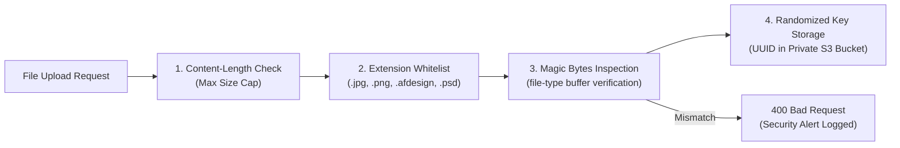

# CRELUNE — Security, Privacy & Compliance Specification

**Document:** Security Posture, Data Privacy Controls, and Threat Defense Architecture  
**Project:** CRELUNE  
**Version:** 1.0  
**Status:** Approved for Milestone 0 Foundation  
**Primary Reference:** [`docs/PRODUCT_MASTER_SPECIFICATION.md`](file:///d:/Projects/Crelune/docs/PRODUCT_MASTER_SPECIFICATION.md)

---

## 1. Security Philosophy & Threat Model

CRELUNE (*kreh-LOON*) manages personal church community records, family birthdays, member photographs, and creative assets. The founder acts as the sole custodian of this sensitive data.

### Threat Model Matrix

| Threat Vector | Potential Impact | CRELUNE Defense Strategy |
| :--- | :--- | :--- |
| **Public Member Directory Harvesting** | Leakage of church members' names, birth dates, and photos. | Strictly authenticated endpoints; zero unauthenticated public API routes or pages. |
| **Direct S3 / Storage Scraping** | Unauthorized access to member photos or proprietary templates. | Private-by-default buckets; short-lived pre-signed URLs ($\le 15\text{ min}$) with randomized keys. |
| **Malicious File Uploads** | Remote code execution or server compromise via manipulated images. | Dual-layer validation (file extension + magic byte header inspection) and strict size limits. |
| **Arbitrary Remote Command Execution** | Compromise of the founder's Windows workstation via the Agent. | Agent accepts only validated JSON manifests; executes zero arbitrary shell scripts. |
| **Credential & Secret Leaks** | Unauthorized database access or account hijacking. | Zero hardcoded fallback secrets; typed environment validation; `.env*` excluded by `.gitignore`. |
| **SQL Injection & Data Corruption** | Data theft or unauthorized database deletion. | Exclusively parameterized queries via Prisma ORM; non-destructive migration protocols. |

---

## 2. Church Member Privacy Protection Protocol

Church members entrust their personal details to the founder. CRELUNE enforces rigorous privacy standards:

1. **No Public Directories**:
   - Member lists, birthdays, and photographs cannot be queried without an authenticated session.
   - Search indexing (`robots.txt: Disallow: /`) and authentication middleware prevent accidental web crawling.
2. **Access-Controlled Media Storage**:
   - Photographs are never stored with predictable filenames (e.g. `/uploads/photos/1.jpg`).
   - Objects are stored under secure UUID keys: `/members/photos/${uuid}.${extension}`.
   - Images are served solely via pre-signed, time-limited URLs generated upon request for authenticated users (expiry: $15\text{ minutes}$).
3. **Explicit Publication Approval**:
   - The preparation or export of a birthday flyer does not imply permission for automatic public broadcasting.
   - Exported artwork must undergo manual review and approval by the founder before release.

---

## 3. Authentication & Session Architecture

### 3.1 Web Authentication
- **Mechanism**: Secure HTTP-only cookie sessions.
- **Cookie Security Attributes**:
  - `HttpOnly: true` (Prevents client-side JavaScript / XSS access).
  - `Secure: true` (Enforced HTTPS transmission in production).
  - `SameSite: Lax` (Mitigates Cross-Site Request Forgery).
- **Password Storage**: Argon2id or bcrypt with a minimum work factor of 12 rounds. Plaintext or reversibly encrypted passwords are strictly prohibited.
- **No Public Registration**: Self-service registration routes are disabled. Initial setup creates the single owner account via secure CLI initialization.

### 3.2 Mobile Authentication
- **Mechanism**: Cryptographically signed JSON Web Tokens (JWT) or session tokens stored securely on the device using `expo-secure-store` (iOS Keychain / Android Keystore).
- **Token Expiry & Refresh**: Short-lived access tokens (1 hour) coupled with revocable refresh tokens stored in PostgreSQL.

### 3.3 Windows Creative Agent Authentication
- **Mechanism**: Dedicated API key generated per machine.
- **Storage**: The backend stores only a salted cryptographic hash (`tokenHash` via SHA-256) of the agent's key. The raw secret is held locally on the Windows workstation in encrypted user storage.
- **Heartbeat & Revocation**: The agent reports heartbeats every 60 seconds; an administrator can instantly revoke an agent's access from the Web dashboard.

---

## 4. File Upload Defense & Validation

All file uploads (member photos, PSDs, Affinity templates, logo assets) must pass a mandatory 4-step security pipeline before storage:



### File Size Limits
- **Member Photographs**: Maximum $10\text{ MB}$.
- **Affinity Templates & PSDs**: Maximum $100\text{ MB}$.
- **General Creative Assets (Logos/Textures)**: Maximum $50\text{ MB}$.

---

## 5. Windows Creative Agent Safety Constraints

To protect the founder's Windows 11 workstation from remote execution vulnerabilities:

1. **Restricted Job Manifests**: The agent communicates via structured JSON manifests:
   ```json
   {
     "jobId": "job_cuid123",
     "templateId": "tmpl_cuid456",
     "textReplacements": {
       "member_name": "Bro. John Doe",
       "birth_date": "Sunday, 14th October"
     },
     "assetUrl": "https://storage.crelune.com/signed/photo.png?token=..."
   }
   ```
2. **Zero Shell Command Execution**: The agent never accepts shell command strings, batch scripts, or executable binaries from API payloads.
3. **Template Immutability**: All modifications execute on a newly created copy inside a sandboxed job scratch directory (`workspaces/jobs/{jobId}/`). Original templates are marked read-only on the local filesystem.
4. **Process Isolation**: The agent only manages verified Affinity 3.3 processes (`Designer.exe`, `Photo.exe`, `Publisher.exe`).

---

## 6. Secret Hygiene & Environment Management

1. **Zero Hardcoded Secrets**: Secrets must never be committed to source control or hardcoded with fallback values (e.g. `const secret = process.env.SECRET || "dev_secret"` is strictly prohibited).
2. **Strict Git Exclusions**: All `.env*` files are excluded in `.gitignore`. A sanitized template ([`.env.example`](file:///d:/Projects/Crelune/.env.example)) provides non-secret documentation.
3. **Database Parameterization**: All queries use Prisma ORM parameterized queries. Raw string concatenation in SQL is prohibited.
4. **Sanitized Error Responses**: API errors returned to clients must never reveal stack traces, database table structures, or local file system paths:
   ```json
   {
     "success": false,
     "error": {
       "code": "UNAUTHORIZED",
       "message": "Authentication required."
     }
   }
   ```

---

## 7. Milestone 2 Authentication Implementation Controls

Implemented in Milestone 2:
1. **Owner-Only Authentication**:
   - Single-owner baseline strictly enforces that only one owner account exists.
   - Public registration, invitation routes, and client-side account creation are strictly absent.
   - Account provisioning is performed exclusively via the local CLI script [`scripts/create-owner.mjs`](file:///d:/Projects/Crelune/scripts/create-owner.mjs).
2. **Cryptographic Password Security**:
   - Passwords hashed using Node's native `crypto.scrypt` with a random 16-byte salt and constant-time verification ([`apps/web/src/lib/auth/password.ts`](file:///d:/Projects/Crelune/apps/web/src/lib/auth/password.ts)).
3. **Tamper-Evident Session Management**:
   - Session tokens are cryptographically signed using HMAC-SHA256 backed by `SESSION_SECRET` ($\ge 32$ characters) ([`apps/web/src/lib/auth/session.ts`](file:///d:/Projects/Crelune/apps/web/src/lib/auth/session.ts)). Note: session tokens are signed (tamper-evident integrity), not encrypted.
   - Session cookies use `HttpOnly`, `SameSite=Lax`, `Path=/`, and `Secure` in production.
   - Dual-engine verification supports both Node.js server components and Web Crypto Edge runtime in Next.js middleware ([`apps/web/src/middleware.ts`](file:///d:/Projects/Crelune/apps/web/src/middleware.ts)).
4. **Server-Side Route Interception**:
   - Unauthenticated requests to dashboard routes (`/`, `/members`, `/birthdays`, etc.) are intercepted by `middleware.ts` and redirected to `/login`.
   - Protected API routes return `401 Unauthorized` without session cookies.

---

## 8. Milestone 2.1 Security Hardening Specification

Implemented as part of Milestone 2.1 corrective hardening:

1. **Complete Elimination of Fallback Session Secrets**:
   - Hardcoded development fallbacks are completely removed.
   - `SESSION_SECRET` is strictly required in all environments (development, test, production) with a minimum length of 32 characters.
   - All session issuance, verification, and middleware fail closed if `SESSION_SECRET` is missing or insufficient.

2. **Minimized Session Token Claims (Zero PII in Cookies)**:
   - Session cookies carry only minimal operational claims: `{ sub, role: "OWNER", org, iat, exp }`.
   - Personally identifiable information (PII) such as full names and email addresses are never stored in client cookies.
   - Server components and API routes query owner profile details directly from the database using `session.sub`.
   - Strict Zod validation ([`sessionTokenPayloadSchema`](file:///d:/Projects/Crelune/packages/shared/src/schemas/auth.ts)) validates payload structure, positive integer timestamps, clock skew ($\le 60\text{s}$), and enforces `role === 'OWNER'`.

3. **Strict Middleware Route Interception**:
   - Eliminated the permissive `pathname.includes('.')` bypass rule.
   - Whitelist restricted exclusively to internal Next.js assets (`/_next/static`, `/_next/image`, `/favicon.ico`) and exact public routes with strict HTTP method checking:
     - `/login` (GET)
     - `/api/auth/login` (POST only)
     - `/api/auth/logout` (POST only)
     - `/api/health` (GET only)
   - All other routes—including dotted private API endpoints such as `/api/export.json` or `/api/members.csv`—are strictly intercepted and return `401 Unauthorized` when unauthenticated.

4. **Login Anti-Enumeration & Durable Throttling**:
   - Constant-time dummy `scrypt` password verification executes when a queried user does not exist or is inactive, neutralizing response timing enumeration.
   - Account lockout state is tracked durably in PostgreSQL via `failedLoginAttempts` and `lockedUntil`.
   - Accounts lock for 15 minutes after 5 consecutive failed attempts.
   - Generic error responses (`"Invalid email or password"`) are returned for all credential failures without leaking account existence or database error strings.
   - Request payloads are capped at 4KB to mitigate resource exhaustion attacks.

5. **Open Redirect Defense**:
   - Parameter `callbackUrl` is strictly validated to ensure it represents an internal relative path starting with a single `/`.
   - Protocol-relative (`//evil.com`), backslash-relative (`/\evil.com`), and scheme-prefixed paths (`https:`, `javascript:`) are rejected and safely defaulted to `/`.

6. **CSRF Mitigation on Mutation Endpoints**:
   - `GET /api/auth/logout` is removed; logout requires an HTTP POST request.
   - `Origin` and `Referer` headers are validated against the request's `Host` header to prevent cross-site request forgery.

7. **Health Endpoint Information Shielding**:
   - Public unauthenticated requests to `/api/health` receive a minimal status confirmation: `{"status": "ok", "timestamp": "..."}`.
   - Operational diagnostics (database connection status, latency, provider, runtime versions) are gated behind authenticated owner sessions.

8. **Secure Owner Provisioning Tooling**:
   - Command-line password arguments (`--password=...`) are explicitly disallowed in [`scripts/create-owner.mjs`](file:///d:/Projects/Crelune/scripts/create-owner.mjs) to prevent credential leakage into process tables and shell history files.
   - Passwords must be entered interactively via masked console input (`*`).
   - Trivial or common passwords are systematically rejected.
   - Default timezone is established as `Africa/Accra`.
   - Database connection teardown (`prisma.$disconnect()`) is guaranteed on all execution branches.
