# CRELUNE — Quality Assurance & Testing Strategy

**Document:** Comprehensive Testing Framework, Verification Workflows, and Quality Standards  
**Project:** CRELUNE  
**Version:** 1.0  
**Status:** Approved for Milestone 0 Foundation  
**Primary Reference:** [`docs/PRODUCT_MASTER_SPECIFICATION.md`](file:///d:/Projects/Crelune/docs/PRODUCT_MASTER_SPECIFICATION.md)

---

## 1. Quality Assurance Philosophy

In CRELUNE (*kreh-LOON*), **a feature is NEVER complete based solely on successful code compilation or build execution.** 

Code that compiles can still fail on leap years, corrupt creative templates, or expose private member records. Quality is established exclusively through automated test execution, reproducible assertions, and documented proof-of-work.

### Core Testing Mandates
1. **Zero Unverified Claims**: Never report a task as complete without providing the exact test command executed, the number of passing tests, and the exit status.
2. **Template Immutability Assertion**: Every test interacting with design templates must assert that the original master template's SHA-256 checksum remains identical before and after the test.
3. **Deterministic Execution**: Tests must run deterministically with zero dependence on arbitrary `setTimeout` delays.
4. **Regression Prevention**: Previously working functionality must remain unbroken across all milestone progressions.

---

## 2. The CRELUNE Testing Pyramid

```mermaid
flowchart TD
    E2E["End-to-End Workflow Tests (Playwright / Integration Workflows)\nCanonical Founder Workflows (Birthday, Programme, Template)"]
    INT["Integration Tests (Vitest + Supertest + Prisma)\nAPI Routes, Auth Guards, Database Transactions, Signed URLs"]
    UNIT["Unit Tests (Vitest)\nBirthday Calculations, Leap Years, State Machines, Zod Schemas"]

    E2E --> INT
    INT --> UNIT
```



### 2.1 Tier 1: Unit Testing (Vitest)
- **Scope**: Pure functions, business calculations, schema validation, and state machines.
- **Critical Paths Tested**:
  1. *Date & Birthday Calculations*:
     - Leap-year birthdays (February 29 handling).
     - Upcoming birthday query windows (7, 14, 30 days).
     - Year rollover handling (queries spanning December 31 to January 1).
     - Timezone conversion resilience.
  2. *Design Job State Machine*:
     - Valid status transitions: `PENDING` $\rightarrow$ `DISPATCHED` $\rightarrow$ `IN_PROGRESS` $\rightarrow$ `AWAITING_APPROVAL` $\rightarrow$ `COMPLETED`.
     - Invalid status transitions: Prohibiting illegal jumps (e.g. `PENDING` directly to `COMPLETED`).
  3. *Validation Schemas*:
     - Zod schema boundary validation for members, events, templates, and job manifests.

### 2.2 Tier 2: Integration Testing (Vitest + Prisma)
- **Scope**: Interaction between API route handlers, service domain classes, Prisma database transactions, and file storage.
- **Critical Paths Tested**:
  1. *Authentication & Access Control*:
     - Unauthenticated requests return `401 Unauthorized`.
     - Cross-tenant or unpermitted requests return `403 Forbidden`.
  2. *Database Transaction Rollback*:
     - Multi-record mutations (e.g. creating a `DesignJob` and its audit history) roll back completely if an error occurs midway.
  3. *Soft-Delete Enforcement*:
     - Archived members and assets (`archivedAt != null`) are automatically excluded from standard queries.
  4. *File Upload Defense*:
     - Upload endpoints reject manipulated MIME headers, oversized buffers, and disallowed extensions.

### 2.3 Tier 3: End-to-End Workflow Testing
Verification of the three canonical founder workflows from end to end:

#### Workflow A: The Birthday Workflow
```text
[Register Member with Photo] 
        │
        ▼
[Record Birthday Date] 
        │
        ▼
[Trigger Automated Reminder (14 days before)] 
        │
        ▼
[Create Birthday Design Job] 
        │
        ▼
[Agent Prepares Working Copy in Affinity] 
        │
        ▼
[Founder Approval & High-Res Export] 
        │
        ▼
[Mark Published & Reminder Fulfilled]
```

#### Workflow B: The Church Programme Workflow
```text
[Create Church Programme Event] 
        │
        ▼
[Define Creative Deliverables (Flyer, Slide)] 
        │
        ▼
[Generate Linked Design Jobs] 
        │
        ▼
[Complete Artwork & Upload Deliverables] 
        │
        ▼
[Link Output Graphics to Event Record]
```

#### Workflow C: The Template Safety Workflow
```text
[Register Master Template (.afdesign / .psd)] 
        │
        ▼
[Calculate Master File SHA-256 Checksum] 
        │
        ▼
[Inspect Layers & Map Text/Photo Target Nodes] 
        │
        ▼
[Generate Disposable Working Copy in Sandboxed Workspace] 
        │
        ▼
[Execute Layer Text & Photo Replacements on Working Copy] 
        │
        ▼
[Export 300 DPI Graphic from Working Copy] 
        │
        ▼
[Assert Master Template SHA-256 Checksum Unchanged]
```

---

## 3. Tooling & Test Execution Standards

| Environment | Framework | Command | Target Pass Rate |
| :--- | :--- | :--- | :--- |
| **Shared & Backend** | Vitest | `npm run test --workspace=packages/shared` | 100% |
| **Web Application** | Vitest / Testing Library | `npm run test --workspace=apps/web` | 100% |
| **E2E Workflows** | Playwright | `npx playwright test` | 100% |
| **Mobile App** | Jest / React Native Testing Lib | `npm run test --workspace=apps/mobile` | 100% |

---

## 4. Definition of Done Checklist

Before any milestone or significant feature branch is submitted for Product Owner review:

- [ ] All unit tests pass with zero failures (`exit code 0`).
- [ ] All integration tests pass against an isolated local/test database.
- [ ] No previously working tests were skipped (`it.skip`) or commented out.
- [ ] Type checking passes with zero TypeScript errors (`tsc --noEmit`).
- [ ] Linter passes with zero warnings (`npm run lint`).
- [ ] Master template checksum immutability is programmatically verified.
- [ ] The Product Owner receives a comprehensive test execution report detailing commands run, tests executed, and evidence captured.

---

## 5. Milestone 2 Testing Evidence

Automated tests verified for Milestone 2 Web Foundation:
1. **Unit Testing (`npm run test`)**:
   - `@crelune/shared`: 5 tests passed (auth schema validation, environment variable validation).
   - `@crelune/ui`: 3 tests passed (brand color tokens, radii, spacing, shadows).
   - `@crelune/web`: 9 tests passed (scrypt password hashing, salt uniqueness, HMAC-SHA256 session token generation, signature tamper rejection, payload tamper rejection, token expiration, universal Web Crypto Edge verification).
   - **Total**: 17 tests passed, 0 failed.
2. **Type Checking (`npm run type-check`)**:
   - `tsc --noEmit` passed with 0 errors across `@crelune/web`, `@crelune/database`, `@crelune/shared`, `@crelune/ui`.
3. **Production Build (`npm run build`)**:
   - `next build` compiled 17 routes with zero errors.
4. **Live HTTP Server Verification**:
   - `GET /` (unauthenticated): Redirected with `307` to `/login?callbackUrl=%2F`.
   - `GET /api/auth/me` (unauthenticated): Returned `401 Unauthorized`.
   - `GET /api/health`: Returned `200 OK` with database status `healthy`.
