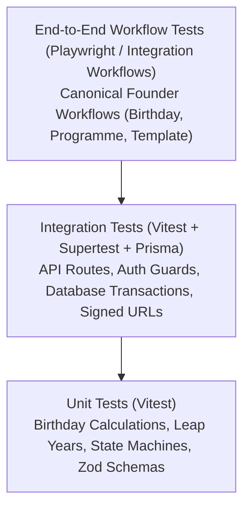

# CRELUNE — Quality Assurance & Testing Strategy

**Document:** Comprehensive Testing Framework, Verification Workflows, and Quality Standards  
**Project:** CRELUNE  
**Version:** 1.0  
**Status:** Approved for Milestone 0 Foundation  
**Primary Reference:** [`docs/PRODUCT_MASTER_SPECIFICATION.md`](file:///d:/Projects/Crelune/docs/PRODUCT_MASTER_SPECIFICATION.md)

---

## 1. Quality Assurance Philosophy

In CRELUNE (*kreh-LOON*), **a feature is NEVER complete based solely on successful code compilation or build execution.** 

Code that compiles can still fail on leap years, corrupt creative templates, or expose private member records. Quality is established exclusively through automated test execution, reproducible assertions, and documented proof-of-work.

### Core Testing Mandates
1. **Zero Unverified Claims**: Never report a task as complete without providing the exact test command executed, the number of passing tests, and the exit status.
2. **Template Immutability Assertion**: Every test interacting with design templates must assert that the original master template's SHA-256 checksum remains identical before and after the test.
3. **Deterministic Execution**: Tests must run deterministically with zero dependence on arbitrary `setTimeout` delays.
4. **Regression Prevention**: Previously working functionality must remain unbroken across all milestone progressions.

---

## 2. The CRELUNE Testing Pyramid



### 2.1 Tier 1: Unit Testing (Vitest)
- **Scope**: Pure functions, business calculations, schema validation, and state machines.
- **Critical Paths Tested**:
  1. *Date & Birthday Calculations*:
     - Leap-year birthdays (February 29 handling).
     - Upcoming birthday query windows (7, 14, 30 days).
     - Year rollover handling (queries spanning December 31 to January 1).
     - Timezone conversion resilience.
  2. *Design Job State Machine*:
     - Valid status transitions: `PENDING` $\rightarrow$ `DISPATCHED` $\rightarrow$ `IN_PROGRESS` $\rightarrow$ `AWAITING_APPROVAL` $\rightarrow$ `COMPLETED`.
     - Invalid status transitions: Prohibiting illegal jumps (e.g. `PENDING` directly to `COMPLETED`).
  3. *Validation Schemas*:
     - Zod schema boundary validation for members, events, templates, and job manifests.

### 2.2 Tier 2: Integration Testing (Vitest + Prisma)
- **Scope**: Interaction between API route handlers, service domain classes, Prisma database transactions, and file storage.
- **Critical Paths Tested**:
  1. *Authentication & Access Control*:
     - Unauthenticated requests return `401 Unauthorized`.
     - Cross-tenant or unpermitted requests return `403 Forbidden`.
  2. *Database Transaction Rollback*:
     - Multi-record mutations (e.g. creating a `DesignJob` and its audit history) roll back completely if an error occurs midway.
  3. *Soft-Delete Enforcement*:
     - Archived members and assets (`archivedAt != null`) are automatically excluded from standard queries.
  4. *File Upload Defense*:
     - Upload endpoints reject manipulated MIME headers, oversized buffers, and disallowed extensions.

### 2.3 Tier 3: End-to-End Workflow Testing
Verification of the three canonical founder workflows from end to end:

#### Workflow A: The Birthday Workflow
```text
[Register Member with Photo] 
        │
        ▼
[Record Birthday Date] 
        │
        ▼
[Trigger Automated Reminder (14 days before)] 
        │
        ▼
[Create Birthday Design Job] 
        │
        ▼
[Agent Prepares Working Copy in Affinity] 
        │
        ▼
[Founder Approval & High-Res Export] 
        │
        ▼
[Mark Published & Reminder Fulfilled]
```

#### Workflow B: The Church Programme Workflow
```text
[Create Church Programme Event] 
        │
        ▼
[Define Creative Deliverables (Flyer, Slide)] 
        │
        ▼
[Generate Linked Design Jobs] 
        │
        ▼
[Complete Artwork & Upload Deliverables] 
        │
        ▼
[Link Output Graphics to Event Record]
```

#### Workflow C: The Template Safety Workflow
```text
[Register Master Template (.afdesign / .psd)] 
        │
        ▼
[Calculate Master File SHA-256 Checksum] 
        │
        ▼
[Inspect Layers & Map Text/Photo Target Nodes] 
        │
        ▼
[Generate Disposable Working Copy in Sandboxed Workspace] 
        │
        ▼
[Execute Layer Text & Photo Replacements on Working Copy] 
        │
        ▼
[Export 300 DPI Graphic from Working Copy] 
        │
        ▼
[Assert Master Template SHA-256 Checksum Unchanged]
```

---

## 3. Tooling & Test Execution Standards

| Environment | Framework | Command | Target Pass Rate |
| :--- | :--- | :--- | :--- |
| **Shared & Backend** | Vitest | `npm run test --workspace=packages/shared` | 100% |
| **Web Application** | Vitest / Testing Library | `npm run test --workspace=apps/web` | 100% |
| **E2E Workflows** | Playwright | `npx playwright test` | 100% |
| **Mobile App** | Jest / React Native Testing Lib | `npm run test --workspace=apps/mobile` | 100% |

---

## 4. Definition of Done Checklist

Before any milestone or significant feature branch is submitted for Product Owner review:

- [ ] All unit tests pass with zero failures (`exit code 0`).
- [ ] All integration tests pass against an isolated local/test database.
- [ ] No previously working tests were skipped (`it.skip`) or commented out.
- [ ] Type checking passes with zero TypeScript errors (`tsc --noEmit`).
- [ ] Linter passes with zero warnings (`npm run lint`).
- [ ] Master template checksum immutability is programmatically verified.
- [ ] The Product Owner receives a comprehensive test execution report detailing commands run, tests executed, and evidence captured.

---

## 5. Milestone 2 Testing Evidence

Automated tests verified for Milestone 2 Web Foundation:
1. **Unit Testing (`npm run test`)**:
   - `@crelune/shared`: 5 tests passed (auth schema validation, environment variable validation).
   - `@crelune/ui`: 3 tests passed (brand color tokens, radii, spacing, shadows).
   - `@crelune/web`: 9 tests passed (scrypt password hashing, salt uniqueness, HMAC-SHA256 session token generation, signature tamper rejection, payload tamper rejection, token expiration, universal Web Crypto Edge verification).
   - **Total**: 17 tests passed, 0 failed.
2. **Type Checking (`npm run type-check`)**:
   - `tsc --noEmit` passed with 0 errors across `@crelune/web`, `@crelune/database`, `@crelune/shared`, `@crelune/ui`.
3. **Production Build (`npm run build`)**:
   - `next build` compiled 17 routes with zero errors.
4. **Live HTTP Server Verification**:
   - `GET /` (unauthenticated): Redirected with `307` to `/login?callbackUrl=%2F`.
   - `GET /api/auth/me` (unauthenticated): Returned `401 Unauthorized`.
   - `GET /api/health`: Returned `200 OK` with database status `healthy`.

---

## 6. Milestone 2.1 Testing Evidence (Security Hardening)

Automated tests verified for Milestone 2.1 Authentication & Security Hardening:
1. **Unit & Integration Testing (`npm test`)**:
   - `@crelune/web`:
     - `src/lib/auth/session.test.ts` (12 tests): verified secret key requirement (fail-closed when missing or $<32$ chars), minimal payload claims without PII, Node.js and Edge Web Crypto verification parity, signature and payload tamper rejection, expired token rejection, clock skew enforcement ($> 60\text{s}$ rejected), non-OWNER role rejection.
     - `src/middleware.test.ts` (17 tests): verified Next.js static asset whitelist (`/_next/static`, `/_next/image`, `/favicon.ico`), interception of dotted private endpoints (`/api/export.json`, `/api/members.csv`, `/api/backup.sqlite` return 401), method checking (`POST /api/auth/login` allowed, `GET /api/auth/login` rejected with 401, `GET /api/health` allowed, `POST /api/health` rejected with 401), authenticated login redirection to `/`, unauthenticated page redirection to `/login?callbackUrl=...`, and fail-closed behavior on missing `SESSION_SECRET` (503 for APIs, redirect for pages).
     - `src/lib/auth/security-hardening.test.ts` (15 tests): verified password strength enforcement (minimum length, rejection of dictionary/trivial passwords, length cap), open redirect protection (relative path validation, rejection of protocol-relative `//`, backslash `/\`, schemes `https:`, `javascript:`, `data:`), CSRF Origin/Referer matching against Host header.
     - `src/lib/auth/password.test.ts` (4 tests): verified scrypt hashing, salt uniqueness, password verification, invalid hash format rejection.
   - `@crelune/shared`:
     - `src/schemas/schemas.test.ts` (8 tests): verified login schema, strict session token payload schema, positive integer timestamps, role literal 'OWNER', environment variable validation.
   - `@crelune/ui`:
     - `src/tokens/tokens.test.ts` (3 tests): verified design tokens, colors, layout tokens.
   - **Total**: 59 automated tests passing across 6 test suites with 0 failures (`PASS`).
2. **Type Checking (`npm run type-check`)**:
   - `tsc --noEmit` passed with 0 errors across `@crelune/web`, `@crelune/database`, `@crelune/shared`, and `@crelune/ui` (`PASS`).
3. **Production Build (`npm run build`)**:
   - `next build` compiled 17 routes and middleware (34.9 kB) with zero errors (`PASS`).
   - `tsc -b` succeeded for all workspace packages (`PASS`).

---

## 7. Milestone 2.1.1 Testing Evidence (Final Authentication Security Corrections)

Automated and live HTTP verification executed for Milestone 2.1.1:
1. **Unit & Integration Testing (`cmd /c npm test`)**:
   - `@crelune/web` (78 tests across 5 files):
     - `src/lib/auth/security-hardening.test.ts` (22 tests): password strength validation, `callbackUrl` open redirect defenses, strict `Origin`/`Referer` validation, malformed headers, `ALLOWED_ORIGINS`, `APP_URL`, and `TRUST_PROXY` proxy header gating.
     - `src/lib/auth/session.test.ts` (15 tests): fail-closed secret enforcement, zero-PII claims with `ver`, Node vs. Web Crypto Edge verification parity (`crypto.subtle.verify`), base64url/UTF-8 tamper rejection, and consistent boundary tests for `exp > iat`, `exp > now`, `iat <= now + 60`, and `exp - iat <= SESSION_TTL_SECONDS`.
     - `src/middleware.test.ts` (19 tests): strict static whitelist, dotted private endpoint interception (`401`), HTTP method enforcement, `/login` redirect handling, and fail-closed `503` HTML/JSON responses (no `/login` self-redirect loop) with intentional `GET /api/health` liveness exception.
     - `src/lib/auth/password.test.ts` (4 tests): scrypt hashing, random salt uniqueness, constant-time verification, malformed hash rejection.
     - `src/app/api/auth/auth-routes.test.ts` (18 tests): `POST /api/auth/login` CSRF + payload limit + indistinguishable `401 Invalid email or password` + concurrent race-safe PostgreSQL `(IP, account)` throttling + IP isolation + `429` IP flood + block expiry auto-recovery, `POST /api/auth/logout` strict CSRF (`403` without `NODE_ENV=test` bypass), `GET /api/auth/me` & `GET /api/health` server-side `isActive` / `sessionVersion` revocation, and direct `verifyActiveOwnerInDatabase` guard tests (with mocked Prisma/cookie store).
   - `@crelune/shared`:
     - `src/schemas/schemas.test.ts` (14 tests): Zod schemas and shared `validateSessionPayload` lifetime boundary validation.
   - `@crelune/ui`:
     - `src/tokens/tokens.test.ts` (3 tests): palette, typography, and layout tokens.
   - **Total**: 95 automated tests passing across 7 test files with 0 failures (`PASS`).
2. **Type Checking (`cmd /c npm run type-check`)**:
   - `tsc --noEmit` passed with 0 errors across `@crelune/web`, `@crelune/database`, `@crelune/shared`, and `@crelune/ui` (`PASS`).
3. **Production Build (`cmd /c npm run build`)**:
   - `next build` compiled 17 routes and Middleware (`52.3 kB`) plus `tsc -b` across `@crelune/database`, `@crelune/shared`, and `@crelune/ui` with exit code `0` (`PASS`).
4. **Live HTTP Server Verification (`next start` on loopback ports `3109` / `3110`)**:
   - With valid `SESSION_SECRET`: verified unauthenticated `GET /` (`307` to `/login?callbackUrl=%2F`), `GET /login` (`200`), `GET /api/auth/me` (`401`), `GET /api/export.json` (`401`), `GET /api/health` (`200`, keys `["status","timestamp"]`, `status: "ok"`), `GET /api/auth/logout` (`401`), `POST /api/auth/login` without Origin (`403`), mismatched Origin (`403`), spoofed `X-Forwarded-Host` (`403`), and `POST /api/auth/logout` without Origin (`403`) (`PASS`).
   - With missing `SESSION_SECRET`: verified `GET /login` (`503`, no redirect loop), `GET /` (`503`), `GET /api/auth/me` (`503`), and `GET /api/health` (`200`, `status: "ok"`) (`PASS`).
5. **Checks Not Executed / Not Configured**:
   - `npm run lint`: ESLint config not initialized in `apps/web` (`next lint` prompts interactively and exits `1`; Next.js built-in type/lint validation still runs during `next build`).
   - Browser E2E UI suite (Playwright/headless browser): `NOT RUN` (not configured in Milestone 2.1.1; HTTP/SSR/middleware behavior verified via Vitest and live `next start` `fetch` harness).

---

## 8. Milestone 2.1.2 Testing Evidence (Rate-Limit Client Identity & PostgreSQL Verification)

Verified for Milestone 2.1.2:
1. **Unit & Route Suites (`cmd /c npm test`)**:
   - `@crelune/web` (`90` tests passing across `6` files, excluding opt-in live PostgreSQL integration file):
     - Added [`src/lib/auth/rate-limit.test.ts`](file:///d:/Projects/Crelune/apps/web/src/lib/auth/rate-limit.test.ts) (`11` tests): strict IPv4/IPv6 validation & canonicalization (`node:net` `isIP`, RFC 5952 IPv6 compression, `::ffff:a.b.c.d` unwrapping, rejection of malformed octets/zone IDs/comma strings), `TRUST_PROXY` proxy header gating, rightmost `X-Forwarded-For` hop extraction, `null` fallback for unknown IP (never `'direct-client'`), unknown-IP `ip:` bucket omission, and opportunistic cleanup cooldown gating.
     - Extended [`src/app/api/auth/auth-routes.test.ts`](file:///d:/Projects/Crelune/apps/web/src/app/api/auth/auth-routes.test.ts) (`19` tests): added route-level unknown-IP fallback verification confirming 25+ random-email probes with `TRUST_PROXY=false` create zero `ip:` rows and never return `429`, while account-specific `acct_noip` throttling still protects the owner's account independently of proxy-verified IP requests.
     - Retained all existing auth/session/middleware/password/security suites (`security-hardening.test.ts` `22`, `session.test.ts` `15`, `middleware.test.ts` `19`, `password.test.ts` `4`).
   - `@crelune/shared`: `src/schemas/schemas.test.ts` (`14` tests passing).
   - `@crelune/ui`: `src/tokens/tokens.test.ts` (`3` tests passing).
   - **Unit/Route Total**: `107` passed, `0` failed, `0` skipped (`PASS`).
2. **Real PostgreSQL Integration Verification (`cmd /c npm run test:integration:db`)**:
   - Executed [`src/lib/auth/rate-limit.pg.integration.test.ts`](file:///d:/Projects/Crelune/apps/web/src/lib/auth/rate-limit.pg.integration.test.ts) directly against Neon Postgres (`auth_throttles` table on endpoint `ep-mute-forest-bepsjmsu`, branch named `production` by Neon default / local dev DB in `.env.local`) using strictly synthetic test keys (`__pg_*`) with automated cleanup (`5` tests, `0` failures, `24.65s` test duration, `PASS`):
     - Verified atomic counter increments under `Promise.all` concurrent `INSERT ... ON CONFLICT DO UPDATE` upserts and threshold activation.
     - Verified active blocks do not extend `blocked_until` on retries and reset cleanly on expiry.
     - Verified independent IP isolation and `clearAccountThrottle` deleting only the authenticated IP+account row.
     - Verified IP aggregate (`20` distinct accounts) block isolation across IPs.
     - Verified unknown-IP (`acct_noip`, zero `ip:` rows) and `pruneExpiredThrottles` deleting only expired test records while preserving active windows/blocks.
   - Verified post-test `auth_throttles` count is `0` (`{"totalAuthThrottleRows":0}`).
3. **Type Checking (`cmd /c npm run type-check`) & Production Build (`cmd /c npm run build`)**:
   - Zero TypeScript errors across all 4 workspaces (`PASS`) and full `next build` + workspace `tsc -b` build succeeded (`PASS`).
