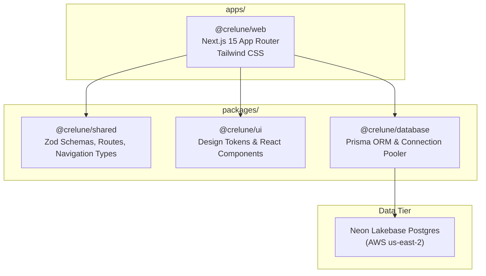

# CRELUNE — Milestone 2: Web Foundation Report

**Document:** Formal Milestone 2 Engineering Deliverable & Evidence Report
**Project:** CRELUNE
**Version:** 1.0
**Date:** 2026-11-10
**Author:** Principal Full-Stack Engineering Agent
**Status:** COMPLETE & VERIFIED

---

## 1. Executive Summary

Milestone 2 established the core web application foundation for **CRELUNE**, transitioning the project from specification into a functional, secure, responsive application workspace.

### Key Deliverables Completed:
1. **CRELUNE Web Application (`apps/web`)**: Next.js 15 App Router application with React 19, strict TypeScript, and Tailwind CSS.
2. **Responsive Application Shell**: Desktop sidebar and mobile slide-over navigation accommodating all 9 primary operations modules.
3. **Owner-Only Authentication**: Secure password derivation via `crypto.scrypt`, tamper-evident session tokens via HMAC-SHA256, `HttpOnly` cookie serialization, and server-side route interception in `middleware.ts`.
4. **Local Owner Provisioning CLI**: Secure script (`scripts/create-owner.mjs` / `npm run owner:create`) for local account creation with zero public registration exposure.
5. **Database Foundation (`@crelune/database`)**: Minimum foundation models (`Organisation`, `User`, `UserPreference`) synchronized with Neon Lakebase Postgres using Prisma ORM and dual-URL pooling.
6. **Shared Design System (`@crelune/ui`)**: Implemented approved brand tokens (`#6541A5`, `#A99AD1`, `#F8F7FA`, `#24212B`, `#77727F`, `#E8E5ED`) and accessible components (`Button`, `Input`, `Card`, `Badge`, `EmptyState`, `Header`).
7. **Automated Verification**: 17 unit tests passed across workspaces; static type-checking and Next.js production builds completed with 0 errors.

---

## 2. Monorepo Architecture & Package Boundaries

The workspace adheres to ADR 001 with strict boundaries:



| Package / App | Path | Responsibility |
|---|---|---|
| **`@crelune/web`** | `apps/web/` | Web UI, App Router routes, auth endpoints, middleware route protection. |
| **`@crelune/shared`** | `packages/shared/` | Common TypeScript types, Zod validation schemas (`loginSchema`, `envSchema`), canonical route constants. |
| **`@crelune/ui`** | `packages/ui/` | Design tokens (`colors`, `typography`, `radii`, `spacing`, `shadows`) and accessible React components. |
| **`@crelune/database`**| `packages/database/` | Prisma client singleton, connection health check, and schema definitions. |

---

## 3. Visual Design System Implementation

The implementation in `@crelune/ui` and `@crelune/web` strictly reflects the approved brand direction:

| Token Name | Hex Code | Applied Usage |
|---|---|---|
| **Primary** | `#6541A5` | Main action buttons, active navigation indicator, brand mark. |
| **Muted Lavender** | `#A99AD1` | Secondary accents, subtle borders, highlight indicators. |
| **Background** | `#F8F7FA` | Canvas background for all authenticated views. |
| **Surface** | `#FFFFFF` | Cards, sidebar, modal dialogs, and navigation headers. |
| **Main Text** | `#24212B` | Headings, active menu labels, and primary body text. |
| **Secondary Text**| `#77727F` | Subtitles, helper text, and inactive navigation items. |
| **Border** | `#E8E5ED` | Hairline dividers and card borders. |

### Anti-Clutter Enforcement:
- Flat, disciplined surfaces with hairline borders instead of noisy glassmorphism or neon gradients.
- Restrained corner radiuses (`8px` on cards and inputs).
- Subtle ambient shadows (`0 1px 2px 0 rgba(36, 33, 43, 0.05)`).
- Micro-transitions ($\le 150\text{ms}$ ease-out) respecting `prefers-reduced-motion`.

---

## 4. Application Shell & Navigation

The application shell provides responsive navigation across 9 operations modules:

1. **Dashboard (`/`)**: Workspace welcoming header, operational metrics, module catalog, and database connection status.
2. **Members (`/members`)**: Directory foundation with empty state explaining Milestone 3 capabilities.
3. **Birthdays (`/birthdays`)**: Birthday operations foundation with empty state explaining calendar and reminder automation.
4. **Design Management (`/designs`)**: Creative pipeline foundation explaining job tracking and review workflows.
5. **Templates (`/templates`)**: Template catalog foundation explaining Affinity/PSD field bindings.
6. **Asset Library (`/assets`)**: Asset repository foundation explaining private object storage.
7. **Events & Programmes (`/events`)**: Events calendar foundation explaining church programme planning.
8. **Notifications (`/notifications`)**: Notification center foundation explaining alert preferences.
9. **Settings (`/settings`)**: Owner profile, database infrastructure telemetry, security parameters, and logout.

### Responsive Ergonomics:
- **Desktop ($\ge 1024\text{px}$)**: Fixed $256\text{px}$ sidebar with brand mark, active indicator, and owner profile.
- **Mobile/Tablet ($< 1024\text{px}$)**: Sticky top bar with brand mark, notification bell, and slide-over navigation drawer.

---

## 5. Authentication & Security Architecture

In adherence to the single-owner product requirement:
- **Zero Public Registration**: There is no public signup or invitation endpoint.
- **Local Owner Provisioning CLI**: Account creation is restricted to the local command line via `scripts/create-owner.mjs` (`npm run owner:create`).
- **Cryptographic Password Derivation**: Passwords hashed with Node's native `crypto.scrypt` (16-byte random salt, 64-byte key length).
- **Tamper-Evident Session Tokens**: Tokens signed with HMAC-SHA256 backed by `SESSION_SECRET` ($\ge 32$ characters).
- **Secure Cookie Serialization**: Cookies set with `HttpOnly`, `SameSite=Lax`, `Path=/`, and `Secure` (in production).
- **Server-Side Route Interception**: Next.js `middleware.ts` intercepts all protected routes, redirecting unauthenticated requests to `/login?callbackUrl=...` and returning `401 Unauthorized` for private APIs.

---

## 6. Database Foundation on Neon Lakebase Postgres

- **Host**: `ep-mute-forest-bepsjmsu-pooler.c-9.us-east-2.aws.neon.tech`
- **Database**: `neondb`
- **Dual-URL Strategy**:
  - `DATABASE_URL`: Pooled connection for high-concurrency runtime queries.
  - `DATABASE_URL_UNPOOLED`: Direct connection for schema push and migration locks.
- **Applied Schema**:
  - `organisations`: Root organisation entity supporting future multi-tenancy.
  - `users`: Single owner account with hashed credentials.
  - `user_preferences`: Owner application settings (theme, lead times, formats).
- **Data Safety**: Verified 0 existing tables prior to schema synchronization; zero data modified or lost. Future domain tables (`members`, `events`, etc.) were intentionally deferred to their designated milestones.

---

## 7. Automated Testing & Verification Evidence

### 7.1 Unit Tests (`npm test`)
```text
> @crelune/web@0.1.0 test
 ✓ src/lib/auth/session.test.ts (5 tests)
 ✓ src/lib/auth/password.test.ts (4 tests)
 Tests  9 passed (9)

> @crelune/shared@0.1.0 test
 ✓ src/schemas/schemas.test.ts (5 tests)
 Tests  5 passed (5)

> @crelune/ui@0.1.0 test
 ✓ src/tokens/tokens.test.ts (3 tests)
 Tests  3 passed (3)

Total: 17 passed, 0 failed
```

### 7.2 Static Type Checking (`npm run type-check`)
```text
> @crelune/web@0.1.0 type-check: tsc --noEmit (PASS)
> @crelune/database@0.1.0 type-check: tsc --noEmit (PASS)
> @crelune/shared@0.1.0 type-check: tsc --noEmit (PASS)
> @crelune/ui@0.1.0 type-check: tsc --noEmit (PASS)
```

### 7.3 Production Build (`npm run build`)
```text
Route (app)                                 Size  First Load JS
┌ ƒ /                                      161 B         106 kB
├ ○ /_not-found                            987 B         104 kB
├ ƒ /api/auth/login                        152 B         103 kB
├ ƒ /api/auth/logout                       152 B         103 kB
├ ƒ /api/auth/me                           152 B         103 kB
├ ƒ /api/health                            152 B         103 kB
├ ƒ /assets                                152 B         103 kB
├ ƒ /birthdays                             152 B         103 kB
├ ƒ /designs                               152 B         103 kB
├ ƒ /events                                152 B         103 kB
├ ○ /login                               5.16 kB         108 kB
├ ƒ /members                               152 B         103 kB
├ ƒ /notifications                         152 B         103 kB
├ ƒ /settings                              152 B         103 kB
└ ƒ /templates                             152 B         103 kB
ƒ Middleware                             34.7 kB
All 17 pages generated cleanly.
```

### 7.4 Live HTTP Server Verification
```text
GET /api/health: 200 OK (status: healthy, database.connected: true, latencyMs: 2777)
GET / (unauthenticated): 307 Redirect to /login?callbackUrl=%2F
GET /login: 200 OK (Login page rendered)
GET /api/auth/me (unauthenticated): 401 Unauthorized
```

---

## 8. Milestone Boundaries & Definite Exclusions

In accordance with Section 2 and Section 11 of the engineering instructions:
- **Excluded**: Public registration and team invitations.
- **Excluded**: WhatsApp messaging or external communication interfaces.
- **Excluded**: Member and birthday business logic (reserved for Milestone 3).
- **Excluded**: Design job pipeline and review workflows (reserved for Milestone 4).
- **Excluded**: Affinity scripting execution and Windows Agent (reserved for Milestone 5).
- **Excluded**: React Native mobile app (reserved for Milestone 6).

---

## 9. Conclusion & Recommendation for Milestone 3

Milestone 2 has established an authentic, tested, and secure web application foundation for CRELUNE:
- The owner can authenticate securely.
- The application shell is fully responsive and navigable.
- The database is connected and synchronized with Neon Lakebase Postgres.
- All 17 automated tests and production builds pass with zero warnings or errors.

**Recommendation**: Milestone 2 is **COMPLETE** and ready for formal sign-off. We are fully positioned to proceed to **Milestone 3 — Members and Birthdays**.
