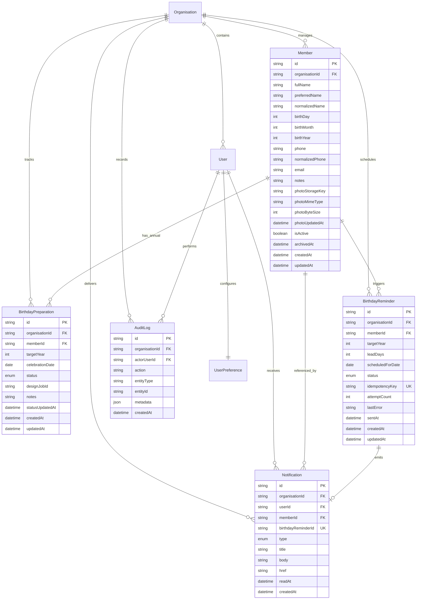

# CRELUNE — Milestone 3 Implementation Plan: Members and Birthdays

**Document:** Milestone 3 Database Isolation, Test Environment Verification & Implementation Plan
**Project:** CRELUNE — Personal Creative and Media Operations Platform
**Current Git Baseline:** `d771da8` (`main`)
**Status:** Preparation & Planning Only — **Feature Implementation Not Yet Authorized**
**Authoritative References:**
- Operating Manual: [`.agents/AGENTS.md`](file:///d:/Projects/Crelune/.agents/AGENTS.md)
- Product Master Specification: [`docs/PRODUCT_MASTER_SPECIFICATION.md`](file:///d:/Projects/Crelune/docs/PRODUCT_MASTER_SPECIFICATION.md)
- Architecture & Database Design: [`docs/ARCHITECTURE.md`](file:///d:/Projects/Crelune/docs/ARCHITECTURE.md), [`docs/DATABASE_DESIGN.md`](file:///d:/Projects/Crelune/docs/DATABASE_DESIGN.md)
- Security & Design System: [`docs/SECURITY.md`](file:///d:/Projects/Crelune/docs/SECURITY.md), [`docs/DESIGN_SYSTEM.md`](file:///d:/Projects/Crelune/docs/DESIGN_SYSTEM.md)

> [!IMPORTANT]
> **Preparation-Only Scope**: No Milestone 3 Prisma schema changes, member features, birthday workflows, or real member records have been created or pushed. All schemas, APIs, and UI views in Sections 3–11 are **proposed designs** awaiting Product Owner approval.

---

## 1. Database Isolation Verification

### 1.1 Pre-Branch Data Safety Inspection
Before branching, the existing `production` branch (`br-withered-moon-be8coj8h`) was inspected safely (counts and schema only, zero credentials or personal record values printed):
- **Tables present**: `auth_throttles`, `organisations`, `user_preferences`, `users`.
- **Row counts**: `organisations: 1`, `users: 1` (`role: OWNER`), `user_preferences: 1`, `auth_throttles: 0`.
- **Conclusion**: Zero member, customer, birthday, or creative asset personal data exists on `production`; only the Milestone 2 single-owner bootstrap exists. Creating `development` from `production` therefore copies no member personal data while preserving local owner login parity.

### 1.2 Neon Environment & Branch Inventory

| Attribute | Production Branch (Baseline Preserved) | Development Branch (Created for M3+) |
| :--- | :--- | :--- |
| **Neon Project ID** | `snowy-glitter-15583384` (`Crelune`, `aws-us-east-2`) | `snowy-glitter-15583384` (`Crelune`, `aws-us-east-2`) |
| **Branch Name** | `production` (`default`, `primary`) | `development` |
| **Branch ID** | `br-withered-moon-be8coj8h` | `br-nameless-silence-bexjp44k` |
| **Endpoint ID** | `ep-mute-forest-bepsjmsu` | `ep-muddy-math-ben8e8p7` |
| **Pooled Host** | `ep-mute-forest-bepsjmsu-pooler.c-9.us-east-2.aws.neon.tech` | `ep-muddy-math-ben8e8p7-pooler.c-9.us-east-2.aws.neon.tech` |
| **Direct Host** | `ep-mute-forest-bepsjmsu.c-9.us-east-2.aws.neon.tech` | `ep-muddy-math-ben8e8p7.c-9.us-east-2.aws.neon.tech` |
| **Database Name** | `neondb` (`public` schema) | `neondb` (`public` schema) |
| **State** | Untouched (`written_data_bytes: 0`) | Checked out in local `.neon`; targeted by `.env.local` |

### 1.3 Live Application & Schema Connection Verification
1. **`.env.local` Target**: Confirmed `NEON_BRANCH="development"`, `NEON_BRANCH_ID="br-nameless-silence-bexjp44k"`, pooled `DATABASE_URL` host `ep-muddy-math-ben8e8p7-pooler.c-9.us-east-2.aws.neon.tech`, direct `DATABASE_URL_UNPOOLED` host `ep-muddy-math-ben8e8p7.c-9.us-east-2.aws.neon.tech`, and `SESSION_SECRET` ($\ge 32$ chars) intact.
2. **Database Schema State on `development`**: Verified PostgreSQL 18.6 (`neondb`, `public` schema) contains `auth_throttles`, `organisations`, `user_preferences`, `users`, and matching Milestone 2.1.2 indexes (`auth_throttles_blocked_until_idx`, `auth_throttles_window_start_idx`, etc.) with counts `organisations: 1`, `users: 1`, `user_preferences: 1`, `auth_throttles: 0`.
3. **Web App (`apps/web`) Connection Test**: Spawned `next start` with stripped parent env variables so [`apps/web/next.config.mjs`](file:///d:/Projects/Crelune/apps/web/next.config.mjs) loaded `../../.env.local` itself. Authenticated `GET /api/health` returned `200`, `status: "healthy"`, `connected: true`, `latencyMs: 574` against `development`.
4. **Production Integrity & Git Hygiene**: Confirmed via `neon branches get production -o json` (`written_data_bytes: 0`, `primary: true`, `default: true`), and via `git check-ignore -v .env.local .neon` that `.env.local` and `.neon` remain excluded from Git.
5. **Remaining Isolation Limitations**:
   - Neon `protected` branch lock is `false` on `production` (`--protected` requires a Neon paid plan).
   - Both branches currently inherit the same initial `OWNER` row until production deployment introduces independent production credentials and secrets.

---

## 2. Integration-Test Environment Verification

### 2.1 Findings on Prior Milestone 2.1.2 Setup
Reviewing `npm run test:integration:db`:
- `dotenv_config_path=../../.env.local` **was** recognized by `node -r dotenv/config` (`dotenv/lib/cli-options.js`), **but**:
  1. Passing `dotenv_config_path=...` after `vitest.mjs run ...` forwarded it to Vitest as a positional file filter argument.
  2. `dotenv/config` used `override: false`, meaning a shell-exported `DATABASE_URL` or `NEON_BRANCH` pointing to `production` could silently bypass `.env.local`.
  3. [`rate-limit.pg.integration.test.ts`](file:///d:/Projects/Crelune/apps/web/src/lib/auth/rate-limit.pg.integration.test.ts) checked only `Boolean(process.env.DATABASE_URL)` and did not verify `NEON_BRANCH` or reject production endpoints.

### 2.2 Corrective Guardrails Implemented
1. Added [`apps/web/src/test/assert-dev-db.ts`](file:///d:/Projects/Crelune/apps/web/src/test/assert-dev-db.ts) (`assertSafeDevDatabaseEnvironment`) and unit tests [`apps/web/src/test/assert-dev-db.test.ts`](file:///d:/Projects/Crelune/apps/web/src/test/assert-dev-db.test.ts) (`5` tests):
   - Rejects `NODE_ENV=production`, missing `DATABASE_URL`, missing/mismatched `NEON_BRANCH`, protected branch names (`production`, `prod`, `main`), production branch ID (`br-withered-moon-be8coj8h`), and production endpoint (`ep-mute-forest-bepsjmsu`) in either `DATABASE_URL` or `DATABASE_URL_UNPOOLED`.
2. Replaced inline `dotenv_config_path` invocation with [`apps/web/scripts/run-pg-integration.mjs`](file:///d:/Projects/Crelune/apps/web/scripts/run-pg-integration.mjs) in [`apps/web/package.json`](file:///d:/Projects/Crelune/apps/web/package.json):
   - Verifies root `.env.local` exists (no silent fallback to `.env`), aborts on pre-existing shell `DATABASE_URL`/`NEON_BRANCH` conflicts, enforces branch/endpoint safety checks before launching Vitest, and passes clean arguments to `vitest.mjs`.
3. `beforeAll` inside [`rate-limit.pg.integration.test.ts`](file:///d:/Projects/Crelune/apps/web/src/lib/auth/rate-limit.pg.integration.test.ts) re-runs `assertSafeDevDatabaseEnvironment(process.env)` and checks `SELECT current_database()` returns `'neondb'`.

### 2.3 Verification Results on `development`
- **`cmd /c npm test`**: `112` passed, `0` failed, `0` skipped across `9` files (includes `5` new guard tests in `assert-dev-db.test.ts`).
- **Negative Production Rejection Check (`set NEON_BRANCH=production&& node apps/web/scripts/run-pg-integration.mjs`)**: Aborted immediately with exit code `1` (`shell NEON_BRANCH="production" conflicts with .env.local`).
- **`cmd /c npm run test:integration:db`**: Target printed `branch="development" (br-nameless-silence-bexjp44k) host="ep-muddy-math-ben8e8p7-pooler.c-9.us-east-2.aws.neon.tech"`; `5/5` tests passed (`21.73s`); post-run `auth_throttles` count verified `0` (`{"devAuthThrottleRows":0}`).
- **`cmd /c npm run type-check`**: `0` errors across all 4 workspaces.

---

## 3. Proposed Database Model and ERD (Milestone 3 Proposal Only)

### 3.1 Reconciliation with Current `schema.prisma` & `DATABASE_DESIGN.md`
Inspecting [`packages/database/prisma/schema.prisma`](file:///d:/Projects/Crelune/packages/database/prisma/schema.prisma) and [`docs/DATABASE_DESIGN.md`](file:///d:/Projects/Crelune/docs/DATABASE_DESIGN.md):
- Current schema has `Organisation`, `User` (`sessionVersion`, `isActive`), `UserPreference` (`theme`, `dateFormat`, `timezone = "Africa/Accra"`, `leadTimeDaysBirthday`, `leadTimeDaysEvent`, `defaultExportFormat`), and `AuthThrottle`.
- `DATABASE_DESIGN.md` draft differences requiring alignment before Stage 3.1 migration:
  1. **Member Name**: Master Specification Section 5 (Module 2) specifies *Full name* (without enforcing split two-box Western surnames). Recommended schema: required `fullName` (`String`) + optional `preferredName` (`String?`) + indexed lowercase `normalizedName` (`String`) for duplicate warnings and fast search. *(Alternative flagged in Section 10 if Product Owner prefers `firstName`/`lastName`).*
  2. **Photo Metadata Without Premature Milestone 8 `Asset` Catalog**: Milestone 8 introduces the full `Asset` library. For Milestone 3, store private photo reference columns directly on `Member` (`photoStorageKey`, `photoMimeType`, `photoByteSize`, `photoUpdatedAt`), keeping `photoAssetId String?` reserved/nullable for future linking in Milestone 8.
  3. **Birthday Preparation Lifecycle (`BirthdayPreparation`)**: Needed to track the 6 approved statuses (`UPCOMING`, `PREPARATION_PENDING`, `DESIGN_IN_PROGRESS`, `AWAITING_APPROVAL`, `PUBLISHED`, `SKIPPED`) per `(memberId, targetYear)` and hold an optional forward-link column (`designJobId String?`) ready for Milestone 4 without creating `DesignJob` prematurely.
  4. **Granular Reminder Schedule (`[7, 3, 1, 0]`)**: `UserPreference.leadTimeDaysBirthday` currently stores a single `Int` (`14`). Add `birthdayReminderDays Int[] @default([7, 3, 1, 0])` and `leapDayPolicy LeapDayPolicy @default(FEB_28)` on `UserPreference` (retaining `leadTimeDaysBirthday` non-destructively for backward compatibility). `BirthdayReminder` adds `leadDays Int` to `@@unique([memberId, targetYear, leadDays])` and date-only `@db.Date` for `scheduledForDate`.
  5. **In-App Notifications & Audit Trail**: Master Specification Milestone 3 includes *In-app notifications* and Security Section 8 requires *Audit records for critical operations*. Introduce compact `Notification` (linked 1:1 optionally to `BirthdayReminder`) and append-only `AuditLog` models, avoiding premature multi-user/mobile/event/template tables.

### 3.2 Proposed ERD (Milestone 3 Scope)

### 3.3 Proposed Key Constraints & Indexes
- `Member`:
  - `birthMonth` (`1..12`), `birthDay` (`1..31`), `birthYear` (`Int?`, never fabricated).
  - Indexes: `@@index([organisationId, isActive, birthMonth, birthDay])`, `@@index([organisationId, normalizedName])`, `@@index([organisationId, normalizedPhone])`, `@@index([organisationId, archivedAt])`.
- `BirthdayPreparation`:
  - Enum `BirthdayPrepStatus { UPCOMING PREPARATION_PENDING DESIGN_IN_PROGRESS AWAITING_APPROVAL PUBLISHED SKIPPED }`.
  - `@@unique([memberId, targetYear])`, `@@index([organisationId, targetYear, status])`, `@@index([organisationId, celebrationDate])`.
- `BirthdayReminder`:
  - Enum `ReminderStatus { PENDING SENT SKIPPED FAILED CANCELLED }`.
  - `@@unique([memberId, targetYear, leadDays])`, `idempotencyKey` (`"bday:${memberId}:${targetYear}:${leadDays}"`), `@@index([organisationId, scheduledForDate, status])`.
- `UserPreference` (alter non-destructively):
  - Enum `LeapDayPolicy { FEB_28 MAR_1 }`.
  - Add `leapDayPolicy LeapDayPolicy @default(FEB_28) @map("leap_day_policy")` and `birthdayReminderDays Int[] @default([7, 3, 1, 0]) @map("birthday_reminder_days")`.

---

## 4. API and Domain Design

### 4.1 Shared Pure Domain Logic (`@crelune/shared`)
- **Validation Schemas**: `memberCreateSchema`, `memberUpdateSchema`, `birthdayStatusUpdateSchema`, `birthdayPreferencesSchema` enforcing trimmed non-empty `fullName`, valid civil `(birthMonth, birthDay)` pairs (allowing Feb 29, rejecting Feb 30 / Apr 31 / etc.), reasonable `birthYear` range (`1900..currentYear` when provided, else `null`), optional phone/email format, notes max length, and `allowSimilar?: boolean`.
- **Timezone-Safe Civil Date Engine (`birthday-date.ts`)**:
  - Represents birthdays strictly as civil tuples (`{ month, day, year?: number }`), never JS UTC `Date` timestamps whose local conversion can shift a calendar day across midnight.
  - Resolves current civil date `{ year, month, day }` in `UserPreference.timezone` (`Africa/Accra` default) using `Intl.DateTimeFormat('en-CA', { timeZone })`.
  - Explicit leap-day resolution: for `(month: 2, day: 29)` in non-leap year `Y`, resolves `(Y, 2, 28)` when `FEB_28` or `(Y, 3, 1)` when `MAR_1`.
  - Computes next upcoming occurrence `{ targetYear, celebrationDateStr, daysRemaining }` consistently across Dec $\rightarrow$ Jan year boundaries.

### 4.2 API Endpoints (Next.js App Router)
Every endpoint below enforces [`resolveAuthenticatedOwner`](file:///d:/Projects/Crelune/apps/web/src/lib/auth/owner-guard.ts), scopes queries by `auth.owner.profile.organisationId`, enforces [`validateRequestOrigin`](file:///d:/Projects/Crelune/apps/web/src/lib/auth/csrf.ts) on mutations (`POST`/`PATCH`/`DELETE`), bounds payload sizes, and logs significant actions to `AuditLog`:

| Route | Method | Responsibility & Behavior |
| :--- | :--- | :--- |
| `/api/members` | `GET` | Search (`q` against `fullName`, `preferredName`, `email`, `phone`), filter (`status=active\|archived\|all`, `month=1..12`), sort (`name_asc\|name_desc\|birthday_asc\|recent`), pagination. |
| `/api/members` | `POST` | Validates input; checks high-similarity duplicates (exact normalized phone/email or same `normalizedName` + `birthMonth`/`birthDay` in org). Returns `409 Conflict` with non-PII duplicate candidate summary unless `confirmDuplicate: true`; writes `Member` + `AuditLog` in `$transaction`. |
| `/api/members/[id]` | `GET`, `PATCH` | Fetches profile + current/next `BirthdayPreparation` + recent audit entries; updates validated fields + audits changes + reconciles future `PENDING` reminders if birthday changed. |
| `/api/members/[id]/archive` | `POST` | Sets `isActive = false`, `archivedAt = now`, cancels `PENDING` future reminders, marks current upcoming prep `SKIPPED` if `UPCOMING`, logs `MEMBER_ARCHIVED`. |
| `/api/members/[id]/restore` | `POST` | Sets `isActive = true`, `archivedAt = null`, regenerates upcoming reminder schedule cleanly without duplicates, logs `MEMBER_RESTORED`. |
| `/api/members/[id]/photo` | `POST`, `GET`, `DELETE` | Private upload (max `10 MB` per `SECURITY.md`, MIME + magic-byte validation for JPEG/PNG/WebP — SVG blocked), authenticated retrieval via `15m` signed storage URL / private stream (`Cache-Control: private, no-store`, `X-Content-Type-Options: nosniff`), delete clears key & removes private object. |
| `/api/birthdays` | `GET` | Returns monthly calendar grid buckets, `today`, `thisWeek`, `thisMonth`, `upcoming` windows, and counts grouped by `BirthdayPrepStatus`. |
| `/api/birthdays/[memberId]/[targetYear]/status` | `PATCH` | Upserts `BirthdayPreparation` and applies explicit manual transition across all 6 approved statuses (`PUBLISHED` strictly manual; never inferred from export), writing `AuditLog`. |
| `/api/notifications` | `GET` | Lists recent owner notifications + unread badge count (`limit`, `unreadOnly`). |
| `/api/notifications/[id]/read` & `read-all` | `PATCH` / `POST` | Marks single or all owner notifications read. |
| `/api/reminders/sync` | `POST` | Triggers idempotent reminder generation/dispatch for owner's organisation (`POST` CSRF-protected from UI, plus `CRON_SECRET`-authenticated scheduled trigger option). |
| `/api/settings/birthdays` | `PATCH` | Updates `timezone`, `leapDayPolicy`, and `birthdayReminderDays` subset of `[7, 3, 1, 0]` (or disabled `[]`), and reconciles `PENDING` reminders cleanly. |

---

## 5. UI/UX Implementation Plan

Adheres strictly to [`docs/DESIGN_SYSTEM.md`](file:///d:/Projects/Crelune/docs/DESIGN_SYSTEM.md) (`#6541A5` primary violet, `#A99AD1` muted lavender, `#F8F7FA` neutral canvas, `#FFFFFF` structured panels, `#24212B` primary text, `#77727F` muted grey, `#E8E5ED` hairline dividers, tabular numbers, zero decorative gradients or badge confetti):

- **Dashboard (`/`)**: Replace the static `Upcoming Birthdays` (`0`) placeholder card with live active member birthday counts (`Today`, `Next 7 days`), unread reminder alerts summary, and direct links to `/members` and `/birthdays` (preserving honest Milestone 4/5/7 placeholder notes on future cards).
- **Members Directory (`/members`)**:
  - Top bar: Search input, status segmented toggle (`Active`, `Archived`, `All`), birth-month filter dropdown, sort selector, and `+ Add Member` primary CTA.
  - Responsive layout: High-density table on desktop (`Avatar/Initials`, `Full Name`, `Birthday` e.g. `14 Oct` or `14 Oct 1994`, `Contact Summary`, `Next Celebration`, `Quick Actions`); clean card rows on mobile (`>= 44px` tap targets).
  - Duplicate warning inline panel inside Add/Edit drawer when server returns `409`, letting owner review existing record or intentionally confirm creation.
- **Member Profile (`/members/[id]`)**:
  - Crisp profile header with private photo (or restrained violet-tinted initials monogram), `Full Name` (+ `Preferred Name`), date-only birthday badge (`Birth Year Unknown` cleanly noted when omitted, never faked), optional contact copy actions, notes block, and Archive/Restore action.
  - Photo upload/replace/remove controls with client preview, file-size/type guidance (`JPEG`, `PNG`, `WebP`, $\le 10\text{ MB}$), and explicit `"Private Workspace Photo — Never Auto-Published"` caption.
  - Annual Birthday Preparation timeline panel showing current/next target year status selector and reserved `"Design Jobs (Milestone 4)"` handoff slot.
- **Birthday Operations (`/birthdays`)**:
  - Dual switchable workspace: **Upcoming Queue** (`Today`, `This Week`, `This Month`, `Upcoming`) + **Interactive Monthly Calendar** (`12`-month switcher highlighting days with member avatars/counts and explicit leap-day indicator notes).
  - Inline Preparation Status control (`Upcoming` $\rightarrow$ `Preparation Pending` $\rightarrow$ `Design in Progress` $\rightarrow$ `Awaiting Approval` $\rightarrow$ `Published` / `Skipped`) with restrained dot indicators instead of bright pill clutter.
  - Thoughtful `EmptyState` patterns when no members exist yet or when a month/search returns 0 birthdays.
- **Notifications Center (`/notifications`)** & **Settings (`/settings`)**:
  - Unread/Read list with direct links to `/members/[id]` and `"Mark read"` actions; Settings section for **Birthday & Timezone Preferences** (`Africa/Accra` default, `Feb 28` vs `Mar 1` leap-day toggle, checkboxes for `7d`, `3d`, `1d`, `Same Day`).

---

## 6. Privacy and Security Design

1. **Strict Single-Owner Access Control**: All APIs and RSC pages verify [`resolveAuthenticatedOwner`](file:///d:/Projects/Crelune/apps/web/src/lib/auth/owner-guard.ts) and bind every Prisma `where` clause to `organisationId`. Zero public member endpoints; `/login` & `/api/health` never leak member counts or names.
2. **Minimum Personal Information**: Only `fullName` and `(birthMonth, birthDay)` are required. `birthYear`, `phone`, `email`, and `notes` remain optional.
3. **Private Photograph Storage & Validation**:
   - Server enforces `10 MB` cap (`SECURITY.md` limit), validates extension + `Content-Type` + **magic bytes** (`FF D8 FF` JPEG, `89 50 4E 47 0D 0A 1A 0A` PNG, `RIFF....WEBP`), rejects SVGs/scripts to eliminate stored XSS vectors.
   - Objects stored in private storage under randomized UUID paths (`/members/photos/{uuid}.{ext}`), never predictable sequential IDs or public web folders.
   - Browser access served strictly via authenticated owner routes (`Cache-Control: private, no-store`, `X-Content-Type-Options: nosniff`) or short-lived (`<= 15 min`) signed URLs; no permanent public URLs; no auto-publishing.
4. **Log Redaction & Audit Integrity**: Application logs avoid dumping member PII (`phone`, `email`, `notes`). `AuditLog` records action type, entity ID, actor ID, and non-PII field-change keys (`changedFields: ["birthDay", "phone"]`) rather than sensitive contact values.
5. **Safe Archival Semantics**: Default removal is reversible **Archive** (`isActive = false`, `archivedAt` timestamp), suppressing reminders while retaining records safely for future Milestone 4 historical `DesignJob` foreign keys. Hard photo removal is explicit and cascades cleanly to storage cleanup.

---

## 7. Reminder Architecture

1. **Timezone-Safe Daily Civil Window**: All reminder due-date math converts `now` into owner's configured IANA timezone (`Africa/Accra` default) as civil `YYYY-MM-DD`, comparing against `resolveCelebrationDateForYear(...)` shifted back by each enabled interval in `birthdayReminderDays` (`[7, 3, 1, 0]`).
2. **Idempotent Multi-Interval Materialization**:
   - Each `(memberId, targetYear, leadDays)` tuple produces at most one `BirthdayReminder` (`@@unique([memberId, targetYear, leadDays])`, `idempotencyKey = "bday:${memberId}:${targetYear}:${leadDays}"`).
   - Within a Prisma `$transaction`, due `PENDING` reminders atomically claim delivery (`UPDATE ... WHERE status = 'PENDING'`), insert the corresponding `Notification` (`birthdayReminderId` unique key prevents duplicates), and mark `BirthdayReminder.status = SENT`, incrementing `attemptCount` or recording `lastError` on failure.
3. **Zero Paid Infrastructure Execution Trigger**:
   - **Primary Guarantee**: Idempotent on-demand sync (`syncRemindersIfStale`) when the owner loads Dashboard / Birthdays / Notifications (debounced/coalesced so normal page loads check minimally).
   - **Background Automated Trigger Options** (zero paid external services): Either a Vercel Cron / Neon Function cron (`*/60 * * * *` or daily `06:00` `Africa/Accra`) OR an OS scheduled task hitting `POST /api/reminders/sync` authenticated via dedicated `CRON_SECRET` timing-safe bearer header.
   - Mobile push notifications wait cleanly until Milestone 6 (reading persisted `Notification` / `BirthdayReminder` records once `DeviceRegistration` & Expo token flow are added).

---

## 8. Controlled Implementation Stages (Not Yet Authorized)

### Stage 3.1 — Milestone 3 Database Schema & Pure Date/Validation Core
- **Objective**: Finalize Prisma schema & pure date/schema logic on `development` branch after PO approves unresolved schema choices.
- **Outcome**: Verified dev database tables and battle-tested civil-date/leap-day calculation engine.
- **DB Changes**: Push approved `Member`, `BirthdayPreparation`, `BirthdayReminder`, `Notification`, `AuditLog`, and `UserPreference` (`leapDayPolicy`, `birthdayReminderDays`) models to `development`.
- **Backend / Domain**: Add Zod schemas & `birthday-date.ts` in `@crelune/shared` + database index tests on `development`.
- **UI**: None.
- **Security**: Enforce non-nullable `organisationId`, strict validation bounds, non-destructive `UserPreference` defaults.
- **Tests**: Unit tests in `@crelune/shared` (leap years `2024`/`2025`/`2026`/`2100`, year-rollover Dec 28 $\rightarrow$ Jan 3, unknown birth year, `Africa/Accra` midnight boundaries) + `@crelune/web` PostgreSQL constraint tests on `development`.
- **Manual Check**: Inspect Neon `development` schema & indexes; verify `production` untouched.
- **DoD**: Schema applied to `development`, `0` TypeScript errors, all shared date/schema tests pass.

### Stage 3.2 — Member Directory API, Duplicate Detection & Audit Logging
- **Objective**: Build authenticated CRUD, search, filter, archival, duplicate warning, and audit trail APIs.
- **Outcome**: Functional server-side member persistence layer protected by owner auth and CSRF.
- **DB Changes**: None (uses Stage 3.1 tables).
- **Backend**: Implement `/api/members`, `/api/members/[id]`, `/api/members/[id]/archive`, `/api/members/[id]/restore`, similarity matcher, `AuditLog` writer.
- **UI**: None (API verification stage).
- **Security**: Owner guard, origin checks on mutations, org-scoped IDOR prevention, generic errors, no PII in server logs.
- **Tests**: Route & integration tests (CRUD, duplicate `409` vs `confirmDuplicate`, archive/restore state, invalid birth dates rejected `400`, CSRF `403`, unauth `401`).
- **Manual Check**: Exercise endpoints locally with curl/Vitest against `development`.
- **DoD**: Member API suite & `type-check` pass with zero regressions.

### Stage 3.3 — Private Member Photograph Storage & Security Pipeline
- **Objective**: Enable safe private upload, replacement, viewing, and deletion of member photos.
- **Outcome**: Owner can attach private portraits to members using validated storage access.
- **DB Changes**: None (uses `Member.photoStorageKey` / metadata columns from Stage 3.1).
- **Backend**: Storage adapter (per Product Owner Decision 1: R2 vs Neon Object Storage vs S3) + `/api/members/[id]/photo` (`POST`/`GET`/`DELETE`) with `10 MB` cap and JPEG/PNG/WebP magic-byte parser.
- **UI**: None (or shared dropzone hook prepared).
- **Security**: Reject disguised `.svg`/`.html`/executable buffers (`400`), strip unsafe headers (`X-Content-Type-Options: nosniff`, `Cache-Control: private, no-store`), UUID object keys, time-limited signed URLs ($\le 15\text{m}$), delete orphaned object on replace/remove.
- **Tests**: Unit tests for magic-byte validator + API integration tests with valid PNG/JPEG/WebP vs spoofed text/SVG payloads and oversized buffers.
- **Manual Check**: Upload real test photo to dev bucket; verify unauthenticated URL access fails (`401`/`403`).
- **DoD**: Private photo upload/serve/delete verified end-to-end without public exposure.

### Stage 3.4 — Birthday Calculation, Preparation Lifecycle & Idempotent Reminder Engine
- **Objective**: Implement upcoming windows, 6-state preparation workflow, Settings updates, and duplicate-free notifications.
- **Outcome**: Server generates and tracks `[7, 3, 1, 0]` birthday reminders and manual preparation states reliably.
- **DB Changes**: None.
- **Backend**: Implement `/api/birthdays`, `/api/birthdays/[memberId]/[targetYear]/status`, `/api/reminders/sync`, `/api/notifications*`, `/api/settings/birthdays`.
- **UI**: None.
- **Security**: Enforce manual-only `PUBLISHED` transitions, idempotency transactions, `CRON_SECRET` guard if external cron calls `/api/reminders/sync`, archived members excluded from reminders.
- **Tests**: PostgreSQL integration tests on `development` verifying `@@unique([memberId, targetYear, leadDays])` prevents duplicates under concurrent sync calls, leap-day policy switching (`FEB_28` vs `MAR_1`), and archival cancellation of pending reminders.
- **Manual Check**: Verify notification rows appear once after repeated sync calls.
- **DoD**: Reminder uniqueness, status transitions, and settings persistence verified against Neon `development`.

### Stage 3.5 — Web UI: Members Directory, Profile & Photo Workflows
- **Objective**: Build polished CRELUNE Web interfaces for `/members`, Add/Edit Member flows, and `/members/[id]`.
- **Outcome**: Owner can manage members, photos, duplicate warnings, notes, and archive/restore visually on desktop & mobile viewports.
- **DB Changes**: None.
- **Backend**: Server Component data loaders using `resolveAuthenticatedOwner()` + client form actions.
- **UI**: New `@crelune/ui` primitives where helpful (`Select`, `Dialog`/`Drawer`, `Pagination`, `Table` tokens) + `/members` + `/members/[id]` + `/members/new` (or slide-over form).
- **Security**: Safe URL handling, zero inline XSS, explicit `"Private"` photo indicators, no leaking sensitive fields in client bundles unnecessarily.
- **Tests**: Form validation tests, component/SSR route auth tests, responsive layout & empty-state checks.
- **Manual Check**: Create, search, filter, upload photo, trigger duplicate confirmation, archive, and restore a synthetic member locally.
- **DoD**: Full member UI flows operational, responsive (`375px` mobile & `1280px` desktop), matching `DESIGN_SYSTEM.md`.

### Stage 3.6 — Web UI: Birthday Calendar, Notifications Center, Dashboard & Settings Wiring
- **Objective**: Complete `/birthdays`, `/notifications`, `/settings` birthday controls, and Dashboard live counters + Milestone 3 QA regression pass.
- **Outcome**: Complete end-to-end Milestone 3 web workspace ready for Product Owner acceptance testing.
- **DB Changes**: None.
- **Backend**: SSR loaders for `/birthdays`, `/notifications`, `/`, and `/settings`.
- **UI**: Interactive monthly calendar grid + Upcoming queue (`Today` / `This Week` / `This Month`), manual 6-status selector, Notification unread badge in sidebar/header, Settings leap-day & `[7,3,1,0]` interval controls, live Dashboard `Upcoming Birthdays` card.
- **Security**: Full unauth/CSRF/IDOR/upload/session-revocation regression sweep.
- **Tests**: Full `npm test`, `npm run type-check`, `npm run test:integration:db`, `npm run build`, plus live HTTP & manual browser E2E walkthrough on `development`.
- **Manual Check**: End-to-end birthday lifecycle from member registration $\rightarrow$ reminder generation $\rightarrow$ notification read $\rightarrow$ manual status transition through `PUBLISHED` $\rightarrow$ archive/restore.
- **DoD**: Zero critical/high bugs, `MILESTONE_3` completion report delivered, Product Owner sign-off obtained before Milestone 4.

---

## 9. Testing Strategy

1. **Unit Tests (`@crelune/shared`, `@crelune/web`, `@crelune/ui`)**:
   - Pure civil birthday calculations across leap years, Dec/Jan wraparound, `Africa/Accra` timezone boundaries, unknown birth years, and Zod validation schemas.
   - Magic-byte file signature inspector, duplicate similarity scoring, and status transition validators.
2. **PostgreSQL Integration Tests (`development` branch via `npm run test:integration:db`)**:
   - Protected by `assertSafeDevDatabaseEnvironment` (strict `development`-branch guard).
   - Verifies concurrent `syncReminders` idempotency (`@@unique([memberId, targetYear, leadDays])`), `BirthdayPreparation` uniqueness, archival reminder cancellation, and synthetic-only cleanup.
3. **API Security & Route Tests**:
   - Unauthenticated `401`, wrong-origin `403`, cross-org IDOR `404`/`403`, malformed date `400`, spoofed file upload `400`, duplicate member conflict `409`.
4. **Build & Manual E2E Verification**:
   - `cmd /c npm test`, `cmd /c npm run type-check`, `cmd /c npm run build`, plus live desktop/mobile browser walkthrough on local `development` server before completion sign-off.

---

## 10. Risks and Unresolved Decisions (Requiring Product Owner Confirmation)

> [!WARNING]
> **Product Owner Decisions Needed Before Stage 3.1**:
> 1. **Private Object Storage Provider (Pending `TECHNICAL_DECISIONS.md` Decision A)**: Recommend **Neon Object Storage** (branches alongside Neon `development`/`production` Postgres, S3-compatible presigned URLs, zero extra vendor account) vs **Cloudflare R2** (zero egress fees). Need selection before Stage 3.3.
> 2. **Member Name Fields**: Approve **`fullName` (required) + optional `preferredName`** (aligns literally with `PRODUCT_MASTER_SPECIFICATION.md` and accommodates single/multi-part church names cleanly) vs split `firstName` + `lastName` in `DATABASE_DESIGN.md`.
> 3. **Default Leap-Day Policy**: Approve default **`FEB_28`** vs **`MAR_1`** for February 29 birthdays in non-leap years (owner can still toggle in Settings).
> 4. **Automated Reminder Trigger Mechanism**: Approve **on-demand sync on workspace open + authenticated daily cron endpoint (`CRON_SECRET`)** (zero paid dependencies, compatible with future Vercel Cron, Neon Function Cron, or Windows Task Scheduler).

**Key Engineering Risks & Mitigations**:
- **Timezone Day-Shift Bugs**: Mitigated by forbidding JS UTC timestamps for member birthdays and persisting integer `(birthMonth, birthDay, birthYear?)` + `@db.Date` celebration dates.
- **Duplicate Reminders Under Concurrency/Retries**: Mitigated by database `@@unique([memberId, targetYear, leadDays])`, unique `Notification.birthdayReminderId`, and atomic claim transactions.
- **Private Photo Leakage**: Mitigated by rejecting public static directories, magic-byte checking, `nosniff`/`no-store` headers, and time-limited private access.

---

## 11. Estimated Complexity and Dependencies

- **Overall Complexity**: **Medium-High** (First full business-domain data model, private binary storage integration, civil-date/leap-year math, idempotent reminders, and multiple responsive UI screens).
- **Stage Sizing**: Stages 3.1–3.4 build the backend/domain/storage spine carefully; Stages 3.5–3.6 deliver clean interactive UI built exclusively against verified backend contracts.
- **External Dependencies**:
  - None required for Stages 3.1–3.2 and 3.4–3.6 (existing Next.js 15, Prisma 6, Zod, Lucide, Neon Postgres).
  - Stage 3.3 requires lightweight AWS S3 SDK (`@aws-sdk/client-s3`, `@aws-sdk/s3-request-presigner`) or approved storage SDK once Decision 1 is confirmed.
- **Out of Scope (Explicitly Deferred)**: Design jobs pipeline (Milestone 4), Template catalog & Affinity desktop automation (Milestone 5), React Native Mobile app (Milestone 6), Events (Milestone 7), full Asset Library (Milestone 8), email/SMS providers, public portals.
